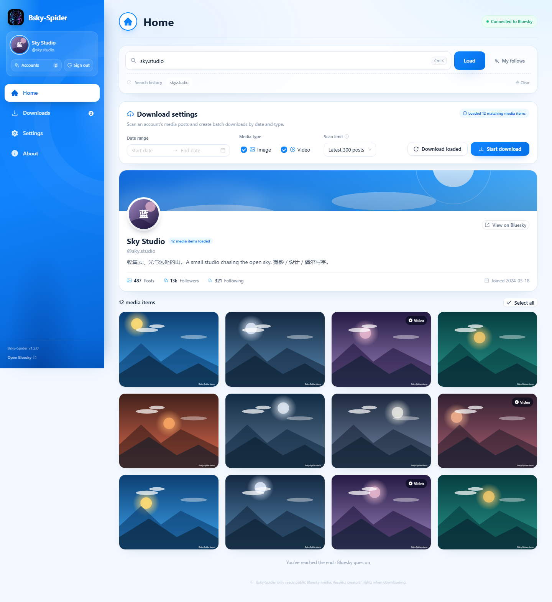

# Bsky-Spider

**English** | [简体中文](README.zh-CN.md) | [繁體中文](README.zh-TW.md) | [Русский](README.ru.md)

**Bluesky media downloader**

> Current version: 1.2.0
> Download: https://github.com/vasttidec/Bsky-Spider/releases/tag/v1.2.0

Bsky-Spider is built on the DeepSeek Harness framework; the whole project was developed with the DeepSeek-V4.1-Flash-1017 model at the Max reasoning level.

Bsky-Spider is a Bluesky image and video downloader that runs entirely on your own machine: sign in securely with an **App Password**, browse any user's media posts, download in bulk by date and type, and save the **original files** rather than transcoded versions whenever possible. The interface keeps the four-page layout of earlier releases (Home / Downloads / Settings / About), and its interaction model is based on [X-Spider](https://github.com/MiningCattiva/x-spider).



## Table of contents

- [Features](#features)
- [How downloads work](#how-downloads-work)
- [Install and run](#install-and-run)
- [Sign-in and auto sign-in](#sign-in-and-auto-sign-in)
- [Usage](#usage)
- [File naming template](#file-naming-template)
- [Settings reference](#settings-reference)
- [Data, privacy, and security](#data-privacy-and-security)
- [Environment variables](#environment-variables)
- [Project structure](#project-structure)
- [Verification scripts](#verification-scripts)
- [FAQ](#faq)
- [Known limitations](#known-limitations)
- [Disclaimer](#disclaimer)
- [Changelog](#changelog)
- [Credits and license](#credits-and-license)

## Features

- **App Password sign-in**: Your account's main password is never touched; "Remember sign-in credentials" is optional, and the desktop build stores them encrypted with Windows DPAPI and signs in automatically on the next launch.
- **User search**: Accepts a handle, `@handle`, a DID, or a pasted `https://bsky.app/profile/...` link.
- **Following**: Reads the current account's follow list; click any user to jump to their media page.
- **Media browsing**: Fetches a user's media posts and automatically resolves images, videos, and media inside quoted posts (`recordWithMedia`), with grid previews and infinite scrolling.
- **Search history**: Recently searched accounts are stored in the local data directory and remain clickable after a restart.
- **Filtering and bulk download**: Create tasks by date range, image/video type, and scan limit (100/300/500/1000/all); download a single item, the selected items, or the current filtered results in one go.
- **Downloads**: Downloading / Error / Completed tabs with live progress, speed, and ETA; supports pause, resume, retry, delete, open file, and open containing folder.
- **Original quality first**: Both videos and images are downloaded as the original blob from the author's PDS via `com.atproto.sync.getBlob` (original MP4 / JPEG / PNG) instead of the CDN's WebP images or HLS-transcoded video.
- **FFmpeg-free video muxing**: HLS fallback streams are losslessly remuxed into MP4 by the built-in TypeScript muxer (stream copy only, no re-encoding).
- **Account manager**: Multiple accounts can be saved (App Passwords encrypted with Windows DPAPI) and switched from the sidebar with one click; the list shows avatars, display names, and full handles, and "Keep sign-in credentials" can be set per account.
- **Themes**: Follow system / Bluesky / Dark / Cyberpunk.
- **Languages**: System language, Simplified Chinese (zh-CN), Traditional Chinese (zh-TW), English (en-US), Russian (ru-RU).
- **Proxy support**: Automatically uses the Windows system proxy or the `HTTPS_PROXY` / `HTTP_PROXY` environment variables, and also accepts a manually entered HTTP/HTTPS proxy.
- **Configurable**: Save path, folder template, file name template, skip files that already exist, concurrency, request timeout, download complete notification, and one-click restore of default settings.
- **Privacy**: All requests originate from a local Node.js service and media is written straight to a local folder; no account data or downloaded content is uploaded.

## How downloads work

### 1. Where the media comes from

| Media | Preferred source | Fallback source |
| --- | --- | --- |
| Video | The **original uploaded MP4** on the author's PDS (`com.atproto.sync.getBlob`) | Bluesky HLS transcoded stream (highest rendition) |
| Image | The **original blob** on the author's PDS (original JPEG / PNG / WebP, etc.) | CDN `fullsize` (usually WebP) |

Bluesky's CDN converts images to another format and serves videos as HLS transcodes (typically 360p / 720p). Original files only exist on the author's PDS, so Bsky-Spider will:

1. Resolve the author's PDS address through the DID document of their `did:plc` / `did:web` (cached — each author is resolved only once);
2. Call `com.atproto.sync.getBlob` with the `cid` to fetch the original file;
3. Choose the extension from the response `Content-Type` (`.mp4` / `.jpg` / `.png` / `.webp` / `.gif` / `.avif`, etc.);
4. Fall back to the CDN / HLS only when the original file returns an error or the returned content is not an image or video, and mark the task with "original file unavailable, fell back to the Bluesky transcoded version".

> Measured: for the same video, the original file can be 1080×1920 while the top HLS rendition is 720×1280.

### 2. Download engine

Single-file downloads are handled by `server/download-engine.ts`, behaving the same way X-Spider gets multi-connection downloads from aria2:

1. Probe `Content-Type`, `Content-Length`, and `Range` support with `HEAD` (degenerating to a 1-byte range request on failure);
2. If the server supports ranges and the file is ≥ 2 MB, write it in parallel chunks over up to **6 connections** into the same file;
3. If the server does not support ranges (as with Bluesky's PDS blob endpoint), degenerate to a single-connection stream;
4. Every failed attempt retries automatically, up to 3 times, with a backoff starting at 600 ms; HTTP 4xx responses and content-type errors are not retried;
5. Temporary files stay in the target directory (`.bsky-<task ID>.part`); if the server supports `Range`, resuming continues from the breakpoint;
6. Timeout protection: 20 s to connect, 45 s for response headers, 90 s of data silence.

### 3. HLS fallback

1. Read the master playlist and pick the highest rendition by `BANDWIDTH` / `RESOLUTION`;
2. Parse the media playlist: segment list, `EXT-X-MAP` initialization segment, `EXT-X-KEY` encryption tags (encrypted streams fail immediately instead of saving an unplayable file);
3. Download segments **4 at a time** into `.bsky-<task ID>.parts/` and concatenate them in order when done; after an interruption, "Resume" reuses segments that already finished, and stale segments are discarded automatically when the playlist changes;
4. If the stream is fMP4 (`EXT-X-MAP` + `.m4s`), concatenating the initialization segment and the segments in order yields a playable MP4;
5. If the stream is MPEG-TS (Bluesky's current transcode format), it is handed to the built-in muxer.

### 4. Built-in MP4 muxing engine (replaces FFmpeg)

`server/remux/` is an MPEG-TS → MP4 converter that only does stream copying, implemented entirely in TypeScript:

| Module | Responsibility |
| --- | --- |
| `ts-demux.ts` | Parses 188-byte TS packets, PAT/PMT, and PES headers; extracts H.264 / AAC elementary streams and PTS/DTS |
| `h264.ts` | Annex B splitting, SPS parsing (resolution / frame rate), `avcC` generation, and converting access units into MP4 samples |
| `aac.ts` | ADTS frame splitting and `AudioSpecificConfig` generation |
| `mp4-writer.ts` | Writes `ftyp` / `mdat` / `moov` (`mvhd`, `tkhd`, `mdhd`, `hdlr`, `stsd`, `avcC`, `esds`, `stts`, `ctts`, `stss`, `stsc`, `stsz`, `stco`, etc.) |
| `index.ts` | Timeline normalization, audio/video start alignment, and invoking the muxer to output MP4 |

Highlights:

- **Copy only, never re-encode** — quality is identical to the source stream;
- Handles 33-bit timestamp wraparound and per-segment timestamp restarts automatically; audio and video stay in sync;
- Output is a progressive MP4 (`moov` at the end of the file) that plays directly in Chromium / Windows / common players;
- A failed conversion never loses the file: the `.ts` is kept and the task is marked "video muxing failed, kept as a .ts file";
- MP4 files use a faststart layout (`moov` before `mdat`), so players and Windows Explorer can read the duration immediately and generate a cover thumbnail.
- The `.ts` is kept only when the muxer cannot parse the stream (for example, the codec is not H.264/AAC), and the task is clearly marked.

## Install and run

### Option 1: Portable ZIP (recommended)

1. Download `Bsky-Spider-1.2.0-win-x64.zip` from the repository (or use the same file in the local `release/` folder) and extract it;
2. Enter the `Bsky-Spider` folder and double-click **`Bsky-Spider.exe`**;
3. Nothing to install — no Node.js or FFmpeg required.

SHA256 (ZIP): `3914EA8259D41FF04F3F349E3AB9CB8FDCBB4981411F28CE70BF01783DE5D8B0`

- If Windows warns that "this file came from another computer", right-click the ZIP → Properties → check "Unblock", then extract;
- Do not double-click the exe directly inside the archive preview window;
- If startup fails, check `data\server.log` next to the exe (or `%APPDATA%\Bsky-Spider\data\server.log` when that is not writable).

### Option 2: Run from source

Requires **Node.js 20 or newer**.

```bash
npm install
npm run build
npm start            # opens http://127.0.0.1:5179
```

On Windows you can also double-click **`start-bsky-spider.bat`**: the script installs dependencies, builds, and starts the app, then opens the browser.

Development mode (Vite hot reload + API server):

```bash
npm run dev
# UI:  http://127.0.0.1:5178
# API: http://127.0.0.1:5179
```

### Rebuilding packages

```bash
npm run build:exe       # release/Bsky-Spider-1.2.0-portable.exe
npm run build:zip       # release/Bsky-Spider-1.2.0-win-x64.zip (includes the win-unpacked folder)
```

`build:zip` internally runs `build:exe:dir` (which produces `release/win-unpacked`) and `scripts/build-zip.ps1`.

## Sign-in and auto sign-in

1. In Bluesky, open **Settings → App Passwords** (<https://bsky.app/settings/app-passwords>);
2. Create an App Password and copy the credential, which looks like `xxxx-xxxx-xxxx-xxxx`;
3. In the Bsky-Spider sidebar, click **Sign in to Bluesky** and enter your handle (or email) and App Password;
4. The sign-in window offers a **Remember sign-in credentials** checkbox (checked by default).

- The desktop build encrypts the account, App Password, and optional custom PDS with **Windows DPAPI** and stores them in `<next to the exe>/data/accounts.enc`, then signs in automatically on the next launch;
- If automatic sign-in fails (revoked credentials, network or proxy unavailable), the sign-in window opens with the saved account pre-filled;
- Click **Account manager** in the sidebar to switch between saved accounts, add accounts, or delete them; each account's App Password is encrypted separately with Windows DPAPI;
- In "Account manager" you can set **Keep sign-in credentials** per account: the current account signs in automatically on the next launch when checked; unchecked accounts are removed before the next launch (they no longer appear in the account manager and cannot be switched to); an account's credentials can also be deleted directly from "Account manager";
- Clicking **Sign out** deletes the current account's sign-in credentials; if other saved accounts exist, the app automatically switches to and signs in with one of them, otherwise it enters a fully signed-out state (the sidebar only keeps "Sign in to Bluesky");
- Browser / source mode has no Electron secure storage, so credentials live in memory only and there is no automatic sign-in;
- When using a self-hosted PDS, expand "Custom PDS (advanced)" in the sign-in window and enter the address; the sign-in flow validates HTTPS automatically.

## Usage

1. On the home page, enter a user handle (for example `bsky.app`) and click **Load**;
2. Filter by date range, media type, and scan limit; hover over the grid to preview, download a single item, or open the original post;
3. Select multiple media items and click **Download selected**, or click **Start download** to have the server re-scan that user's media posts;
4. Open **Downloads** to watch progress and pause / resume / retry / open files;
5. In **Settings**, adjust the save location, templates, concurrency, proxy, and more — changes are saved automatically.

After a download finishes, a subtle toast appears centered at the top of the window for about **2 seconds** (multiple tasks are merged into one count). You can turn it off in **Settings → App → Download complete notification**.

### Pause and resume

- Pausing aborts the current connection immediately; data already written stays in the temporary file;
- Resuming re-queues the task: original-file downloads continue from the breakpoint when possible (if the server supports `Range`), and the HLS fallback reuses segments that already finished;
- After the app restarts, unfinished tasks return to "Waiting" and can be resumed or deleted.

## File naming template

Default template:

```text
Folder: %USER_HANDLE%
File name: %POST_TIME%_%USER_HANDLE%_%MEDIA_ID%%EXT%
```

Available variables:

| Variable | Meaning |
| --- | --- |
| `%POST_ID%` | The post's rkey |
| `%POST_TIME%` | Publish time; `%POST_TIME,d=1%` for the date only |
| `%USER_HANDLE%` | User handle |
| `%USER_NAME%` | User display name |
| `%USER_DID%` | User DID |
| `%MEDIA_ID%` | Identifier of the media within the post |
| `%MEDIA_INDEX%` | Index of the media within the post (starting at 1) |
| `%MEDIA_TYPE%` | `image` / `video` |
| `%MEDIA_WIDTH%` / `%MEDIA_HEIGHT%` | Media dimensions (when available) |
| `%TEXT%` | Post text; `%TEXT,t=16%` truncates to 16 characters |
| `%EXT%` | Extension (including the dot), corrected automatically from the actual response content type |

- Folder templates support `/` for multiple directory levels; leave it empty to save directly under the save path;
- Illegal characters in variable values are replaced, and Windows-reserved file names are prefixed automatically, preventing path traversal and overwrites;
- "Settings" provides a live path preview and one-click restore of the recommended template.

## Settings reference

| Group | Setting | Description |
| --- | --- | --- |
| Appearance | Theme | Follow system / Bluesky / Dark / Cyberpunk; updates live when the system theme changes |
| Appearance | Language | Follow system / Simplified Chinese / Traditional Chinese / English / Russian |
| Storage | Save path | Root folder for media, default `~/Downloads/Bsky-Spider`; can be opened or reselected |
| Storage | Folder template | Supports variables and multiple directory levels |
| Storage | File name template | Supports variables and appends the extension automatically |
| Downloads | Skip identical files | Skip when the target file already exists (on by default) |
| Downloads | Concurrent downloads | Number of simultaneous downloads, 1–6, default 3 |
| Network | Enable proxy | The proxy is used for both the Bluesky API and media downloads |
| Network | Use system proxy | Reads the Windows proxy / `HTTPS_PROXY` / `HTTP_PROXY` automatically; turn it off to enter one manually |
| Network | Proxy address | Manual HTTP/HTTPS proxy, for example `http://127.0.0.1:7890` |
| Network | Request timeout | Timeout for a single Bluesky API request, 10–120 seconds, default 30 |
| App | Download complete notification | In-window toast toggle, on by default |
| App | Check for updates | Reads GitHub Releases and compares it with the current version; can open the download page |
| App | Data directory | Shows the current data directory; can be opened with one click |
| App | Restore default settings | Restores theme, language, save path, templates, concurrency, proxy, and timeout in one click (does not affect downloaded files or task records) |
| App | Environment | Version, Node.js, platform, video engine, AppView, API address |

The built-in MP4 muxing engine starts with the app and is always enabled; it does not depend on any external program, and the Settings page no longer shows related options.

## Data, privacy, and security

- Desktop data directory: **the `data` folder next to `Bsky-Spider.exe`** — it is always read when it exists; `%APPDATA%\Bsky-Spider\data` is used only when it does not exist and cannot be created; old data is migrated automatically on first launch
- Browser / source mode: `data/` in the project
- Settings `settings.json`, task records `tasks.json`, search history `history.json` (partitioned per account DID)
- Auto sign-in credentials: `data/accounts.enc` (encrypted with Windows DPAPI; multiple accounts supported)
- Runtime log: `data/server.log`
- Startup diagnostics: `%APPDATA%\Bsky-Spider\startup.log` (records the data directory actually used and the migration result)
- Current session: server memory only + HttpOnly cookie
- Downloaded files: the save path from Settings, default `~/Downloads/Bsky-Spider`
- The server only listens on `127.0.0.1` and is not exposed to the local network

The app never publishes content, never modifies accounts, and never sends account information, cookies, App Passwords, or downloaded content to any third-party server. Media requests go from the local service directly to Bluesky / the author's PDS.

## Environment variables

| Variable | Default | Description |
| --- | --- | --- |
| `BSKY_SPIDER_PORT` | `5179` | API / production page port |
| `BSKY_SPIDER_HOST` | `127.0.0.1` | Listen address |
| `BSKY_SPIDER_DATA_DIR` | `./data` | Settings and task data directory |
| `BSKY_SPIDER_APPVIEW` | `https://public.api.bsky.app` | AppView address |
| `BSKY_SPIDER_PDS` | `https://bsky.social` | Default PDS sign-in address |
| `BSKY_SPIDER_OPEN` | unset | Set to `1` to open the browser automatically after launch |
| `BSKY_SPIDER_AUTO_LOGIN` | unset | Private: one-time auto sign-in credentials passed from the desktop main process to the local service |

## Project structure

```text
src/                  React pages, components, i18n, and Zustand state
server/
  index.ts            Express API and static asset server
  bsky.ts             Bluesky XRPC client, media resolution, feed fetching
  auth.ts             Sign-in / session / rate limiting
  pds.ts              DID document resolution, original blob URLs
  downloads.ts        Download queue, task state, candidate sources and fallback
  download-engine.ts  Single-file download engine (multi-connection / retries / resume)
  hls.ts              HLS playlist parsing
  remux/              Built-in MPEG-TS → MP4 muxer (replaces FFmpeg)
  proxy.ts            System proxy detection
  storage.ts          Settings persistence
  http.ts             undici + proxy + timeout wrapper
shared/               Types and naming templates shared by the frontend and backend
electron/             Electron main process, preload, splash screen, and logo
public/               UI logos, PWA manifest, licenses
build/                Packaging icons (icon.ico / icon-512.png)
scripts/              Verification, UI automation, and screenshot scripts
data/                 Generated at runtime (gitignored)
```

Tech stack:

- Frontend: React 18, TypeScript, Vite, Ant Design 5, Tailwind CSS, Zustand, Day.js
- Server: Node.js, Express, undici (HTTP/HTTPS proxy), streamed file-system downloads
- Media processing: in-project TypeScript H.264/AAC demuxing and MP4 muxing (no external binaries)
- Protocol: AT Protocol XRPC (`com.atproto.server.createSession`, `app.bsky.actor.getProfile`, `app.bsky.feed.getAuthorFeed`, `com.atproto.sync.getBlob`)

## Verification scripts

Install dependencies and build first, then run.

```bash
npm run test             # TypeScript type checking
npm run test:original    # Real network: original JPEG/MP4 download + HLS fallback through the built-in muxer, validating the MP4 structure
npm run test:auth        # App Password sign-in, JWT refresh, feed media resolution (local mock)
npm run test:server      # HTTP sign-in cookie, session, authorization, bulk download, sign-out (local mock)
npm run test:download    # Image + HLS segment merging; re-download when a completed file is missing
npm run test:pause       # Pause, immediate resume, Range resume
npm run test:proxy       # System proxy detection and reaching Bluesky through the proxy (needs network)
npm run test:proxy-auto  # Auto-enable when a system proxy is detected, and no reset after a manual disable
npm run test:auto-login  # Auto sign-in and proxy settings persisted across restarts
npm run test:history    # Search history isolation per account and legacy data migration (local)
```

UI automation and screenshots need a local Chrome / Edge and a running production server:

```bash
npm start
# another terminal
npm run test:ui      # Sign-in, search, preview, download, settings persistence, About, mobile layout
npm run screenshot   # Generates screenshots/*.png (using mock data)
```

`test:original` will:

1. Download the original blobs of an image and a video from real posts and validate the JPEG magic bytes and the MP4 `ftyp/moov`;
2. Force the same video through the HLS fallback and validate that the output is an MP4 with `moov` / `mdat` / `avcC`, then check the duration;
3. Use a multi-segment video with audio to validate that the audio track is written correctly (`mp4a`), and compare it against the audio stream in the source segments' PMT.

## FAQ

**Q: Do I still need to install FFmpeg?**

No. Since 1.0.0 the app neither bundles nor invokes FFmpeg; HLS remuxing is done by the built-in TypeScript engine and always outputs MP4.

**Q: Why are some videos only 720p?**

Bluesky's HLS transcodes usually only offer 360p / 720p renditions. Bsky-Spider prefers the original MP4 on the author's PDS (for example 1080×1920); it only falls back to an HLS rendition when the original has been cleaned up, and it marks the task accordingly.

**Q: The downloaded image is WebP, not the original?**

That means the post's original blob is no longer available and the app fell back to the CDN `fullsize`, which always returns WebP. When the original blob is available it is saved as JPEG / PNG.

**Q: Why does a failed task say "original file unavailable"?**

The blob on the author's PDS may have been deleted, or that PDS may not allow anonymous reads; the app then falls back to the transcoded version automatically. When the fallback succeeds the task still shows as completed, just with a note.

**Q: How do I set up a proxy?**

The app detects the Windows system proxy at startup (and also supports `HTTPS_PROXY` / `HTTP_PROXY`) and enables it automatically when found. If the system proxy is not recognized (PAC or SOCKS-only setups), turn off "Use system proxy" in Settings and enter an HTTP/HTTPS proxy address.

**Q: What if automatic sign-in fails?**

Open the sign-in window and enter the details again; checking "Remember sign-in credentials" updates the saved credentials. To delete local credentials, delete the account in "Account manager", or uncheck "Keep sign-in credentials" for it and restart.

**Q: Will I lose progress if the app crashes mid-download?**

No files are lost. Unfinished tasks are kept as "Waiting/Paused" and temporary files stay in the target directory; completed HLS fallback segments are reused when you resume.

## Known limitations

- Only media posts from a user's author feed are read; search, likes, bookmarks, and private content are not available for download.
- Bluesky / AppView rate limits may cause bulk scans to fail; lower the scan limit or retry later.
- Original blobs require the author's PDS to be publicly readable; if the PDS refuses anonymous access or does not expose the sync endpoint, the app falls back to the CDN / HLS transcoded version.
- The built-in muxer supports H.264 video + AAC audio (the combination used by all of Bluesky's current transcodes); other codecs (such as HEVC) keep the `.ts` file and show a notice.
- HLS streams protected by DRM / encryption are not supported.
- Automatic sign-in is only available in the Windows desktop build; browser mode does not save App Passwords.

## Disclaimer

- This tool is only for backing up content you have the right to save. Please respect the original authors' copyright and the Bluesky community rules.
- Do not use this tool for bulk scraping, harassment, or any purpose that violates the Bluesky Terms of Service.
- Bsky-Spider is not affiliated with Bluesky, PBC.
- Please comply with the laws, regulations, and regulatory requirements of your country.

## Changelog

- **1.2.0**: first publicly released version of Bsky-Spider.

## Credits and license

- UI/interaction blueprint and download approach reference: [X-Spider](https://github.com/MiningCattiva/x-spider) by [MiningCattiva](https://github.com/MiningCattiva) (GPL-3.0)
- App Password sign-in and media fetching reference: [Bluesky-Media-Downloader](https://github.com/maxreinartz/Bluesky-Media-Downloader) by [maxreinartz](https://github.com/maxreinartz) (MIT)
- Built-in MP4 muxing engine: implemented by this project; it only copies streams and contains no FFmpeg code

Bsky-Spider is released under **GPL-3.0-only**; see [LICENSE](LICENSE) for the full text.
