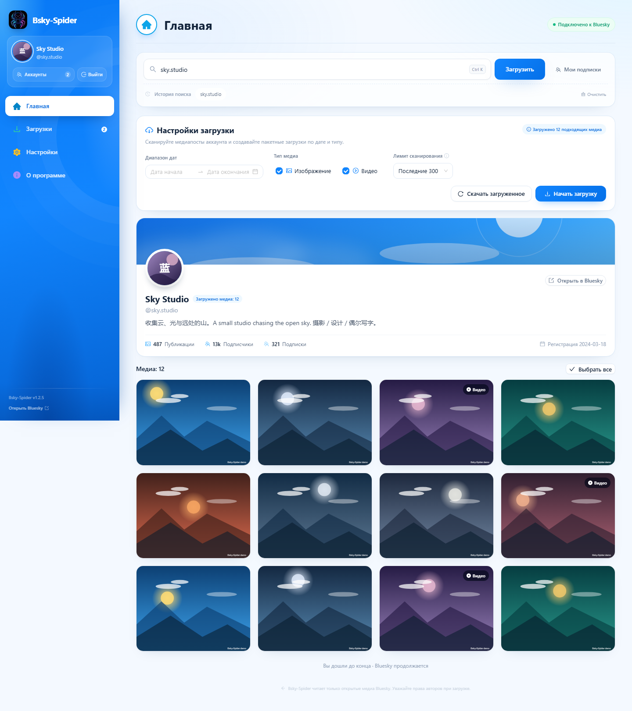

# Bsky-Spider

[English](README.md) | [简体中文](README.zh-CN.md) | [繁體中文](README.zh-TW.md) | **Русский**

**Загрузчик медиа Bluesky**

> Текущая версия: 1.2.5
> Скачать: https://github.com/vasttidec/Bsky-Spider/releases/tag/v1.2.5

Bsky-Spider создан на платформе DeepSeek Harness: весь проект разработан с помощью модели DeepSeek-V4.1-Flash-1017 с уровнем рассуждений Max.

Bsky-Spider — это инструмент для загрузки изображений и видео из Bluesky, который полностью работает на локальной машине: безопасный вход через **App Password**, просмотр медиа-постов любого пользователя, пакетная загрузка по датам и типам и, по возможности, сохранение **исходных файлов** вместо перекодированных версий. Интерфейс сохраняет четырёхстраничную структуру прежних версий (Главная / Загрузки / Настройки / О программе), а за основу взаимодействия взят [X-Spider](https://github.com/MiningCattiva/x-spider).



## Содержание

- [Возможности](#возможности)
- [Как работает загрузка](#как-работает-загрузка)
- [Установка и запуск](#установка-и-запуск)
- [Вход и автоматический вход](#вход-и-автоматический-вход)
- [Порядок работы](#порядок-работы)
- [Шаблон имён файлов](#шаблон-имён-файлов)
- [Описание настроек](#описание-настроек)
- [Данные, конфиденциальность и безопасность](#данные-конфиденциальность-и-безопасность)
- [Переменные среды](#переменные-среды)
- [Структура проекта](#структура-проекта)
- [Проверочные скрипты](#проверочные-скрипты)
- [Частые вопросы](#частые-вопросы)
- [Известные ограничения](#известные-ограничения)
- [Отказ от ответственности](#отказ-от-ответственности)
- [Журнал изменений](#журнал-изменений)
- [Благодарности и лицензия](#благодарности-и-лицензия)

## Возможности

- **Вход через App Password**: основной пароль аккаунта не затрагивается; можно установить флажок «Запомнить учётные данные» — настольная версия шифрует и сохраняет их через Windows DPAPI и выполняет автоматический вход при следующем запуске.
- **Поиск пользователя**: поддерживаются Handle, `@handle`, DID или вставка ссылки `https://bsky.app/profile/...`.
- **Мои подписки**: читает список подписок текущего аккаунта; выберите любого пользователя, чтобы перейти на его страницу медиа.
- **Просмотр медиа**: загружает медиа-посты пользователя, автоматически разбирает изображения, видео и медиа из цитируемых постов (`recordWithMedia`), показывает сетку предпросмотра с поддержкой бесконечной прокрутки.
- **История поиска**: недавно найденные аккаунты сохраняются в локальном каталоге данных и остаются доступны для выбора после перезапуска.
- **Фильтры и пакетная загрузка**: задачи создаются по диапазону дат, типу (изображения/видео) и лимиту сканирования (100/300/500/1000/все); поддерживается загрузка одного файла, загрузка выбранного и загрузка текущих результатов фильтра за один раз.
- **Загрузки**: три вкладки — «Загружается» / «Ошибки» / «Завершено», прогресс, скорость и ETA в реальном времени; поддерживаются пауза, продолжение, повтор, удаление, открытие файла и открытие папки с файлом.
- **Приоритет оригинального качества**: и видео, и изображения в первую очередь загружаются как исходный blob через `com.atproto.sync.getBlob` на PDS автора (исходные MP4 / JPEG / PNG), а не как WebP с CDN или перекодированное HLS-видео.
- **Объединение видео без FFmpeg**: резервный HLS-поток без потерь преобразуется в MP4 встроенным упаковщиком на TypeScript (только копирование аудио- и видеопотоков, без перекодирования).
- **Управление аккаунтами**: можно сохранять несколько аккаунтов (App Password шифруются Windows DPAPI) и переключаться в боковой панели одним нажатием; список показывает аватар, отображаемое имя и полный handle, а флажок «Хранить учётные данные» задаётся для каждого аккаунта отдельно.
- **Несколько тем**: как в системе / Bluesky / тёмная / киберпанк.
- **Несколько языков**: язык системы, китайский упрощённый (zh-CN), китайский традиционный (zh-TW), английский (en-US), русский (ru-RU).
- **Поддержка прокси**: автоматически читает системный прокси Windows или переменные окружения `HTTPS_PROXY` / `HTTP_PROXY`; HTTP/HTTPS-прокси можно указать и вручную.
- **Гибкая настройка**: путь сохранения, шаблон папки, шаблон имени файла, пропуск файлов с тем же именем, число параллельных загрузок, тайм-аут запроса, уведомление о завершении загрузки — плюс сброс настроек одним нажатием.
- **Приватность**: все запросы выполняет локальная служба Node.js, медиа записываются сразу в локальную папку, данные аккаунта и загруженное содержимое никуда не отправляются.

## Как работает загрузка

### 1. Откуда берутся медиа

| Медиа | Приоритетный источник | Резервный источник |
| --- | --- | --- |
| Видео | **Исходный загруженный MP4** на PDS автора (`com.atproto.sync.getBlob`) | Перекодированный HLS-поток Bluesky (высший профиль) |
| Изображения | **Исходный blob** на PDS автора (исходный формат JPEG / PNG / WebP и т. п.) | `fullsize` с CDN (обычно WebP) |

CDN Bluesky конвертирует изображения в другой формат и отдаёт видео в виде HLS-транскодинга (обычно 360p / 720p). Исходные файлы существуют только на PDS автора, поэтому Bsky-Spider:

1. через документ DID `did:plc` / `did:web` определяет адрес PDS автора (с кешированием — для одного автора разбор выполняется один раз);
2. по `cid` вызывает `com.atproto.sync.getBlob` и получает исходный файл;
3. определяет расширение по `Content-Type` ответа (`.mp4` / `.jpg` / `.png` / `.webp` / `.gif` / `.avif` и т. п.);
4. переходит на CDN / HLS только если исходный файл вернул ошибку или его содержимое не является изображением/видео, и помечает задачу: «Исходный файл недоступен, выполнен переход на перекодированную версию Bluesky».

> Проверено на практике: для одного и того же видео исходный файл может быть 1080×1920, тогда как высший профиль HLS — 720×1280.

### 2. Движок загрузки

Загрузку отдельного файла выполняет `server/download-engine.ts`; поведение соответствует подходу X-Spider к многопоточной загрузке через aria2:

1. сначала запросом `HEAD` (при сбое — Range-запросом на 1 байт) определяются `Content-Type`, `Content-Length` и поддержка `Range`;
2. если сервер поддерживает диапазоны и файл ≥ 2 MB, запись в тот же файл идёт параллельно сегментами **не более чем в 6 соединений**;
3. если сервер не поддерживает диапазоны (так ведёт себя конечная точка blob на PDS Bluesky), выполняется потоковая запись по одному соединению;
4. каждая неудачная попытка повторяется автоматически, до 3 раз, с задержкой от 600 ms; HTTP 4xx и ошибки типа содержимого не повторяются;
5. временный файл остаётся в целевой папке (`.bsky-<ID задачи>.part`), и при поддержке `Range` продолжение загрузки идёт с места обрыва;
6. защита от тайм-аутов: соединение 20 s, заголовки ответа 45 s, молчание данных 90 s.

### 3. Откат на HLS

1. читает главный плейлист и выбирает высший профиль по `BANDWIDTH` / `RESOLUTION`;
2. разбирает медиаплейлист: список сегментов, инициализирующий сегмент `EXT-X-MAP`, метку шифрования `EXT-X-KEY` (для зашифрованного потока сразу выдаётся ошибка — невоспроизводимый файл не сохраняется);
3. сегменты загружаются **в 4 потока** в `.bsky-<ID задачи>.parts/` и после завершения объединяются по порядку; после прерывания «продолжить загрузку» использует уже скачанные сегменты, а при изменении плейлиста старые сегменты автоматически аннулируются;
4. если поток fMP4 (`EXT-X-MAP` + `.m4s`), инициализирующий сегмент вместе с сегментами, склеенными по порядку, уже даёт воспроизводимый MP4;
5. если поток MPEG-TS (текущий формат транскодинга Bluesky), его обрабатывает встроенный упаковщик.

### 4. Встроенный движок объединения MP4 (вместо FFmpeg)

`server/remux/` — это конвертер MPEG-TS → MP4, который выполняет только «копирование потоков» и полностью реализован на TypeScript:

| Модуль | Назначение |
| --- | --- |
| `ts-demux.ts` | Разбирает TS-пакеты по 188 байт, PAT/PMT, заголовки PES, извлекает элементарные потоки H.264 / AAC и PTS/DTS |
| `h264.ts` | Разделение Annex B, разбор SPS (разрешение / частота кадров), формирование `avcC`, преобразование единиц доступа в сэмплы MP4 |
| `aac.ts` | Разбор кадров ADTS, формирование `AudioSpecificConfig` |
| `mp4-writer.ts` | Запись `ftyp` / `mdat` / `moov` (`mvhd`, `tkhd`, `mdhd`, `hdlr`, `stsd`, `avcC`, `esds`, `stts`, `ctts`, `stss`, `stsc`, `stsz`, `stco` и т. д.) |
| `index.ts` | Нормализация таймлайна, выравнивание начал аудио и видео, вызов упаковщика для вывода MP4 |

Особенности:

- **Только копирование, без перекодирования** — качество полностью совпадает с исходным потоком;
- автоматически обрабатывает переполнение 33-битных меток времени и перезапуск меток в сегментах, аудио и видео всегда синхронны;
- на выходе прогрессивный MP4 (`moov` в конце файла), который напрямую воспроизводят Chromium / Windows / распространённые плееры;
- при сбое преобразования файл не теряется: сохраняется `.ts`, а задача помечается «Не удалось упаковать видео, файл сохранён как .ts»;
- MP4 использует раскладку faststart (`moov` перед `mdat`), поэтому плееры и Проводник Windows могут сразу прочитать длительность и построить миниатюру обложки.
- `.ts` сохраняется только если упаковщик не может разобрать поток (например, кодек не H.264/AAC); задача явно помечается.

## Установка и запуск

### Способ 1: ZIP-версия без установки (рекомендуется)

1. Скачайте из репозитория `Bsky-Spider-1.2.5-win-x64.zip` (или используйте файл с тем же именем в локальной папке `release/`) и распакуйте;
2. перейдите в папку `Bsky-Spider` и дважды щёлкните **`Bsky-Spider.exe`**;
3. установка не требуется, Node.js и FFmpeg тоже не нужны.

SHA256 (ZIP): `4069D3F8037BF166FEDC0BE9F21EB9850D1CFC38005FC51A2AC2C13E37003F6B`

- если Windows сообщает «Файл получен из интернета», щёлкните ZIP правой кнопкой → Свойства → установите флажок «Разблокировать» и только затем распакуйте;
- не запускайте exe двойным щелчком прямо в окне предпросмотра архива;
- при сбое запуска смотрите `data\server.log` рядом с exe (если туда нельзя писать — `%APPDATA%\Bsky-Spider\data\server.log`).

### Другие пакеты

- **Установщик Windows**: `Bsky-Spider-1.2.5-win-x64-setup.exe` — устанавливается в `C:\Program Files\Bsky-Spider` (для всех пользователей, требуются права администратора); на последней странице можно создать ярлык на рабочем столе и запустить приложение.
- **Linux**: `Bsky-Spider-1.2.5.AppImage` и `Bsky-Spider-1.2.5.deb` (x64); папка загрузок по умолчанию — `~/Downloads/Bsky-Spider`.

### Способ 2: запуск из исходников

Требуется **Node.js 20 или новее**.

```bash
npm install
npm run build
npm start            # открывает http://127.0.0.1:5179
```

В Windows можно также дважды щёлкнуть **`start-bsky-spider.bat`**: скрипт установит зависимости, выполнит сборку, запустит приложение и откроет браузер.

Режим разработки (горячая перезагрузка Vite + API-сервис):

```bash
npm run dev
# UI:  http://127.0.0.1:5178
# API: http://127.0.0.1:5179
```

### Пересборка

```bash
npm run build:exe       # release/Bsky-Spider-1.2.5-portable.exe
npm run build:zip       # release/Bsky-Spider-1.2.5-win-x64.zip (включая каталог win-unpacked)
```

Внутри `build:zip` выполняются `build:exe:dir` (создаёт `release/win-unpacked`) и `scripts/build-zip.ps1`.

## Вход и автоматический вход

1. В Bluesky откройте **Settings → App Passwords** (<https://bsky.app/settings/app-passwords>);
2. создайте App Password и скопируйте учётные данные вида `xxxx-xxxx-xxxx-xxxx`;
3. в боковой панели Bsky-Spider нажмите **Войти в Bluesky** и укажите Handle (или почту) и App Password;
4. в окне входа можно установить флажок **Запомнить учётные данные** (установлен по умолчанию).

- настольная версия шифрует аккаунт, App Password и необязательный собственный PDS через **Windows DPAPI** и сохраняет их в `<каталог рядом с exe>/data/accounts.enc`, выполняя автоматический вход при следующем запуске;
- при неудаче автоматического входа (учётные данные отозваны, сеть или прокси недоступны) открывается окно входа с уже подставленным сохранённым аккаунтом;
- кнопка **Управление аккаунтами** в боковой панели позволяет переключаться между сохранёнными аккаунтами, добавлять и удалять их; App Password каждого аккаунта шифруется и сохраняется отдельно через Windows DPAPI;
- в «Управлении аккаунтами» для каждого аккаунта отдельно задаётся флажок **Хранить учётные данные**: если у текущего аккаунта он установлен, при следующем запуске выполняется автоматический вход; аккаунты без флажка удаляются до следующего запуска (больше не появляются в управлении аккаунтами, переключиться на них нельзя); удалить учётные данные аккаунта можно и напрямую кнопкой удаления в «Управлении аккаунтами»;
- нажатие **Выйти** удаляет учётные данные текущего аккаунта; если есть другие сохранённые аккаунты, приложение автоматически переключится и выполнит вход в один из них, иначе произойдёт полный выход (в боковой панели останется только «Войти в Bluesky»);
- в режиме браузера / из исходников нет безопасного хранилища Electron: учётные данные находятся только в памяти, автоматический вход не выполняется;
- при использовании собственного PDS можно развернуть в окне входа раздел «Собственный PDS (для опытных)» и указать адрес; процесс входа автоматически проверит HTTPS.

## Порядок работы

1. на главной странице введите Handle пользователя (например, `bsky.app`) и нажмите **Загрузить**;
2. отфильтруйте по диапазону дат, типу медиа и лимиту сканирования; в сетке можно навести курсор для предпросмотра, скачать отдельный файл или открыть исходный пост;
3. отметьте несколько медиа и нажмите **Скачать выбранное** либо сразу **Начать загрузку**, чтобы сервер заново просканировал медиа-посты этого пользователя;
4. в **Загрузках** следите за прогрессом, ставьте на паузу / продолжайте / повторяйте / открывайте файл;
5. в **Настройках** задайте путь сохранения, шаблоны, параллельность, прокси и т. п. — изменения сохраняются автоматически.

После завершения загрузки вверху по центру окна приложения примерно на **2 секунды** появляется всплывающее уведомление (несколько задач объединяются в общий счётчик); отключить его можно в **Настройки → Приложение → Уведомление о завершении загрузки**.

### Пауза и продолжение

- пауза немедленно разрывает текущее соединение; уже записанные данные сохраняются во временном файле;
- при продолжении задача ставится в очередь заново: загрузка исходного файла по возможности продолжается с места обрыва (если сервер поддерживает `Range`), а резервный HLS сразу использует уже загруженные сегменты;
- после перезапуска приложения незавершённые задачи восстанавливаются как «Ожидание», и их можно продолжить или удалить.

## Шаблон имён файлов

Шаблон по умолчанию:

```text
Папка: %USER_HANDLE%
Имя файла: %POST_TIME%_%USER_HANDLE%_%MEDIA_ID%%EXT%
```

Доступные переменные:

| Переменная | Значение |
| --- | --- |
| `%POST_ID%` | rkey поста |
| `%POST_TIME%` | Время публикации; `%POST_TIME,d=1%` — только дата |
| `%USER_HANDLE%` | Handle пользователя |
| `%USER_NAME%` | Отображаемое имя пользователя |
| `%USER_DID%` | DID пользователя |
| `%MEDIA_ID%` | Идентификатор медиа внутри поста |
| `%MEDIA_INDEX%` | Порядковый номер медиа в посте (с 1) |
| `%MEDIA_TYPE%` | `image` / `video` |
| `%MEDIA_WIDTH%` / `%MEDIA_HEIGHT%` | Размеры медиа (если известны) |
| `%TEXT%` | Текст поста; `%TEXT,t=16%` — обрезать до 16 символов |
| `%EXT%` | Расширение (с точкой), автоматически уточняется по фактическому типу содержимого ответа |

- шаблон папки поддерживает `/` для многоуровневых каталогов; если оставить его пустым, файлы сохраняются прямо в путь сохранения;
- недопустимые символы в значениях переменных заменяются, зарезервированные имена Windows автоматически получают префикс — так исключаются обход пути и перезапись;
- в «Настройках» доступны предпросмотр пути в реальном времени и сброс к рекомендуемому шаблону одним нажатием.

## Описание настроек

| Группа | Настройка | Описание |
| --- | --- | --- |
| Внешний вид | Тема | Как в системе / Bluesky / тёмная / киберпанк, обновляется сразу при смене системной темы |
| Внешний вид | Язык | Как в системе / китайский упрощённый / китайский традиционный / английский / русский |
| Хранение | Путь сохранения | Корневой каталог для медиа, по умолчанию `~/Downloads/Bsky-Spider`; можно открыть или выбрать заново |
| Хранение | Шаблон папки | Поддерживает переменные и многоуровневые каталоги |
| Хранение | Шаблон имени файла | Поддерживает переменные, расширение добавляется автоматически |
| Загрузка | Пропускать одинаковые файлы | Пропускать, если целевой файл уже существует (включено по умолчанию) |
| Загрузка | Число параллельных загрузок | Количество одновременно загружаемых задач, 1–6, по умолчанию 3 |
| Сеть | Включить прокси | Прокси используется и для Bluesky API, и для загрузки медиа |
| Сеть | Использовать системный прокси | Автоматически читает прокси Windows / `HTTPS_PROXY` / `HTTP_PROXY`; можно отключить и указать вручную |
| Сеть | Адрес прокси | Прокси HTTP/HTTPS вручную, например `http://127.0.0.1:7890` |
| Сеть | Тайм-аут запроса | Тайм-аут одного запроса к Bluesky API, 10–120 секунд, по умолчанию 30 |
| Приложение | Уведомление о завершении загрузки | Переключатель всплывающего уведомления в окне, включён по умолчанию |
| Приложение | Проверить обновления | Читает GitHub Releases и сравнивает с текущей версией, может открыть страницу загрузки |
| Приложение | Каталог данных | Показывает текущий каталог данных, открывается одним нажатием |
| Приложение | Сбросить настройки | Одним нажатием возвращает тему, язык, путь сохранения, шаблоны, параллельность, прокси и тайм-аут (не затрагивает загруженные файлы и записи задач) |
| Приложение | Среда выполнения | Версия, Node.js, платформа, видеодвижок, AppView, адрес API |

Встроенный движок объединения MP4 запускается вместе с приложением, всегда включён и не зависит от внешних программ; соответствующие параметры на странице настроек больше не отображаются.

## Данные, конфиденциальность и безопасность

- Каталог данных настольной версии: **папка `data` рядом с `Bsky-Spider.exe`** — если эта папка существует, используется именно она; `%APPDATA%\Bsky-Spider\data` применяется только когда её нет и создать её нельзя; при первом запуске старые данные переносятся автоматически
- Режим браузера / из исходников: `data/` в проекте
- Настройки `settings.json`, записи задач `tasks.json`, история поиска `history.json` (сохраняется с разделением по DID аккаунта)
- Учётные данные для автоматического входа: `data/accounts.enc` (шифрование Windows DPAPI, можно хранить несколько аккаунтов)
- Журнал работы: `data/server.log`
- Диагностика запуска: `%APPDATA%\Bsky-Spider\startup.log` (фиксирует фактически используемый каталог данных и результат переноса)
- Текущая сессия: только память сервера + HttpOnly Cookie
- Загруженные файлы: путь сохранения из настроек, по умолчанию `~/Downloads/Bsky-Spider`
- Служба слушает только `127.0.0.1` и не доступна в локальной сети

Приложение не публикует контент, не изменяет аккаунт и не отправляет данные аккаунта, Cookie, App Password или загруженное содержимое на сторонние серверы. Запросы медиа отправляются локальной службой напрямую в Bluesky / PDS автора.

## Переменные среды

| Переменная | Значение по умолчанию | Описание |
| --- | --- | --- |
| `BSKY_SPIDER_PORT` | `5179` | Порт API / рабочей страницы |
| `BSKY_SPIDER_HOST` | `127.0.0.1` | Адрес прослушивания |
| `BSKY_SPIDER_DATA_DIR` | `./data` | Каталог настроек и данных задач |
| `BSKY_SPIDER_APPVIEW` | `https://public.api.bsky.app` | Адрес AppView |
| `BSKY_SPIDER_PDS` | `https://bsky.social` | PDS-адрес для входа по умолчанию |
| `BSKY_SPIDER_OPEN` | не задано | Установите `1`, чтобы после запуска автоматически открыть браузер |
| `BSKY_SPIDER_AUTO_LOGIN` | не задано | Приватное: одноразовые учётные данные автовхода, передаваемые главным процессом настольной версии локальной службе |

## Структура проекта

```text
src/                  страницы React, компоненты, i18n и состояние Zustand
server/
  index.ts            Express API и сервис статических ресурсов
  bsky.ts             клиент Bluesky XRPC, разбор медиа, получение Feed
  auth.ts             вход / сессия / ограничение частоты
  pds.ts              разбор документа DID, URL исходного blob
  downloads.ts        очередь загрузок, состояние задач, кандидаты-источники и откат
  download-engine.ts  движок загрузки одного файла (несколько соединений / повторы / докачка)
  hls.ts              разбор плейлиста HLS
  remux/              встроенный упаковщик MPEG-TS → MP4 (замена FFmpeg)
  proxy.ts            определение системного прокси
  storage.ts          сохранение настроек
  http.ts             обёртка undici + прокси + тайм-ауты
shared/               общие типы и шаблоны имён для фронтенда и бэкенда
electron/             главный процесс Electron, preload, заставка и логотип
public/               логотип интерфейса, PWA manifest, лицензии
build/                значки для сборки (icon.ico / icon-512.png)
scripts/              скрипты проверки, UI-автоматизации и скриншотов
data/                 создаётся во время работы (в gitignore)
```

Стек технологий:

- Фронтенд: React 18, TypeScript, Vite, Ant Design 5, Tailwind CSS, Zustand, Day.js
- Серверная часть: Node.js, Express, undici (HTTP/HTTPS-прокси), потоковая загрузка через файловую систему
- Обработка медиа: встроенные в проект демультиплексирование H.264/AAC и упаковка MP4 на TypeScript (без внешних бинарников)
- Протокол: AT Protocol XRPC (`com.atproto.server.createSession`, `app.bsky.actor.getProfile`, `app.bsky.feed.getAuthorFeed`, `com.atproto.sync.getBlob`)

## Проверочные скрипты

Запускаются после установки зависимостей и сборки.

```bash
npm run test             # проверка типов TypeScript
npm run test:original    # реальная сеть: загрузка исходных JPEG/MP4 + резервный HLS со встроенной упаковкой и проверкой структуры MP4
npm run test:auth        # вход через App Password, обновление JWT, разбор медиа в Feed (локальный mock)
npm run test:server      # HTTP-вход с Cookie, сессия, авторизация, пакетная загрузка, выход (локальный mock)
npm run test:download    # изображения + объединение сегментов HLS; повторная загрузка отсутствующего готового файла
npm run test:pause       # пауза, немедленное продолжение, докачка по Range
npm run test:proxy       # определение системного прокси и доступ к Bluesky через прокси (нужна сеть)
npm run test:proxy-auto  # при обнаружении системного прокси включается автоматически и не сбрасывается после ручного отключения
npm run test:auto-login  # автоматический вход и сохранение настроек прокси между перезапусками
npm run test:history     # разделение истории поиска по аккаунтам и перенос старых данных (локально)
```

Для UI-автоматизации и скриншотов нужны локальные Chrome / Edge и предварительно запущенный рабочий сервис:

```bash
npm start
# другой терминал
npm run test:ui      # вход, поиск, предпросмотр, загрузка, сохранение настроек, о программе, мобильная вёрстка
npm run screenshot   # создаёт screenshots/*.png (на тестовых данных)
```

`test:original` выполняет следующее:

1. скачивает исходные blob изображений и видео из реальных постов и проверяет магические числа JPEG и `ftyp/moov` MP4;
2. принудительно переводит то же видео на резервный HLS и проверяет, что на выходе MP4 с `moov` / `mdat` / `avcC`, а также проверяет длительность;
3. на видео с несколькими сегментами и звуком проверяет, что аудиодорожка записана корректно (`mp4a`), и сверяет её с аудиопотоком из PMT исходных сегментов.

## Частые вопросы

**В: Нужно ли ещё устанавливать FFmpeg?**

Нет. Начиная с 1.0.0 приложение не содержит и не вызывает FFmpeg: переупаковку HLS выполняет встроенный движок на TypeScript, и результат всегда MP4.

**В: Почему некоторые видео только в 720p?**

HLS-транскодинг Bluesky обычно предлагает только профили 360p / 720p. Bsky-Spider в первую очередь загружает исходный MP4 с PDS автора (например, 1080×1920) и переходит на профили HLS только когда исходный файл удалён, помечая это в задаче.

**В: Скачанное изображение оказалось WebP, а не оригиналом?**

Это значит, что исходный blob поста недоступен и произошёл переход на `fullsize` с CDN, а CDN всегда отдаёт WebP. Когда исходный blob доступен, файл сохраняется как JPEG / PNG.

**В: Почему задача сообщает «Исходный файл недоступен»?**

Blob на PDS автора мог быть удалён или PDS не разрешает анонимное чтение; в этом случае автоматически выполняется переход на перекодированную версию. Если переход удался, задача всё равно отображается как завершённая, только с примечанием.

**В: Как настроить прокси?**

При запуске программа автоматически определяет системный прокси Windows (также поддерживаются `HTTPS_PROXY` / `HTTP_PROXY`) и включает его при обнаружении. Если системный прокси не распознан (случай PAC или только SOCKS), отключите в настройках «Использовать системный прокси» и укажите адрес HTTP/HTTPS-прокси.

**В: Что делать, если автоматический вход не удался?**

Откройте окно входа и введите данные заново; флажок «Запомнить учётные данные» обновит сохранённые учётные данные. Чтобы удалить локальные учётные данные, удалите соответствующий аккаунт в «Управлении аккаунтами» или снимите у него флажок «Хранить учётные данные» и перезапустите программу.

**В: Потеряется ли прогресс, если программа упала на середине загрузки?**

Файл не потеряется. Незавершённые задачи остаются в состоянии «Ожидание/Пауза», временные файлы хранятся в целевой папке; уже загруженные сегменты резервного HLS используются повторно при продолжении.

## Известные ограничения

- Читаются только медиа-посты из ленты автора; поиск, лайки, закладки и загрузка приватного содержимого не предусмотрены.
- Ограничения частоты Bluesky / AppView могут приводить к сбоям пакетного сканирования — уменьшите лимит сканирования или повторите позже.
- Исходный blob должен быть публично доступен на PDS автора; если PDS запрещает анонимный доступ или не разворачивает sync-интерфейс, происходит переход на перекодированную версию CDN / HLS.
- Встроенный упаковщик поддерживает видео H.264 + аудио AAC (все текущие транскодированные потоки Bluesky используют эту комбинацию); для других кодеков (например, HEVC) сохраняется `.ts` и выводится предупреждение.
- HLS-потоки, защищённые DRM / шифрованием, не поддерживаются.
- Автоматический вход доступен только в настольной версии для Windows; в режиме браузера App Password не сохраняется.

## Отказ от ответственности

- Инструмент предназначен только для резервного копирования контента, право на сохранение которого у вас есть. Уважайте авторские права и правила сообщества Bluesky.
- Не используйте инструмент для массового сбора данных, преследования или любых действий, нарушающих условия Bluesky.
- Bsky-Spider не связан с Bluesky, PBC.
- Соблюдайте законы, нормативные акты и требования регуляторов вашей страны.

## Журнал изменений

- **1.2.5**: сборки для Linux (`.AppImage` и `.deb`) и установщик Windows; плавный режим для слабых компьютеров; индикатор прогресса запуска и исправление зависания на 92% при первом запуске в Linux; определение системного прокси в Linux; обновлённое оформление настроек и цветные значки; сетевые папки сохранения в Windows; оптимизация производительности и очистка кода.
- **1.2.0**: первая публично выпущенная версия Bsky-Spider.

## Благодарности и лицензия

- Прототип интерфейса и взаимодействия, идея загрузки: [X-Spider](https://github.com/MiningCattiva/x-spider) by [MiningCattiva](https://github.com/MiningCattiva) (GPL-3.0)
- Вход через App Password и получение медиа: [Bluesky-Media-Downloader](https://github.com/maxreinartz/Bluesky-Media-Downloader) by [maxreinartz](https://github.com/maxreinartz) (MIT)
- Встроенный движок объединения MP4: реализован в этом проекте самостоятельно, выполняет только копирование потоков и не содержит кода FFmpeg

Bsky-Spider распространяется под лицензией **GPL-3.0-only**, полный текст — в [LICENSE](LICENSE).
