# Bsky-Spider

[English](README.md) | **简体中文** | [繁體中文](README.zh-TW.md) | [Русский](README.ru.md)

> **下载：** [Bsky-Spider-1.2.0-win-x64.zip](https://github.com/vasttidec/Bsky-Spider/releases/latest) · SHA256：`3914EA8259D41FF04F3F349E3AB9CB8FDCBB4981411F28CE70BF01783DE5D8B0`

**Bluesky 媒体下载器 · 本地优先 · 原画质 · 无需 FFmpeg**

> 当前版本 **1.2.0**（Windows x64 桌面版 / 源码运行 / 浏览器模式）
>
> 项目仓库：<https://github.com/vasttidec/Bsky-Spider>

Bsky-Spider 是一个完全在本机运行的 Bluesky 图片与视频下载工具：使用 **App Password** 安全登录，浏览任意用户的媒体帖子，按日期与类型批量下载，并尽可能保存**原始文件**而不是转码版本。界面沿用历代版本的四页结构（主页 / 下载 / 设置 / 关于），交互蓝本来自 [X-Spider](https://github.com/MiningCattiva/x-spider)。

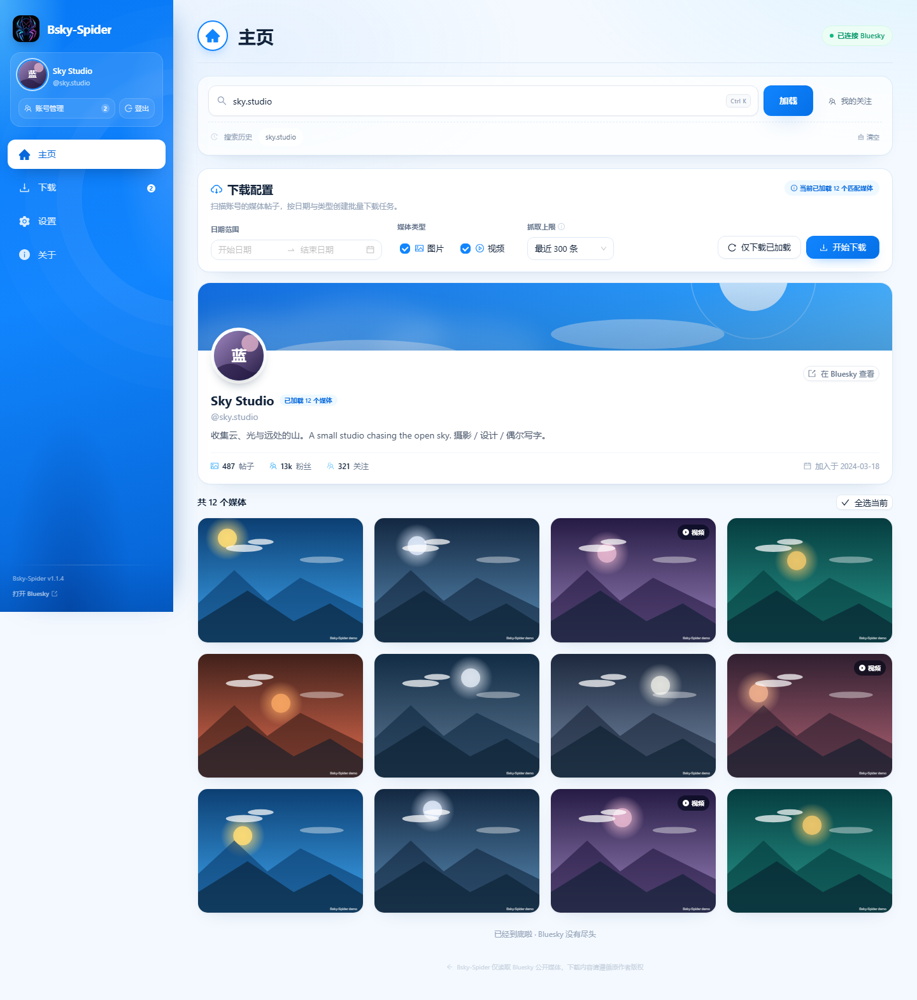

## 目录

- [1.2.0 更新说明](#120-更新说明)
- [1.1.5 更新说明](#115-更新说明)
- [1.1.4 更新说明](#114-更新说明)
- [1.1.3 更新说明](#113-更新说明)
- [1.1.2 更新说明](#112-更新说明)
- [1.1.1 更新说明](#111-更新说明)
- [1.1.0 更新说明](#110-更新说明)
- [1.0.1 更新说明](#101-更新说明)
- [1.0.0 重构说明](#100-重构说明)
- [功能](#功能)
- [界面](#界面)
- [下载原理](#下载原理)
- [安装与运行](#安装与运行)
- [登录与自动登录](#登录与自动登录)
- [使用流程](#使用流程)
- [文件命名模板](#文件命名模板)
- [设置项说明](#设置项说明)
- [数据、隐私与安全](#数据隐私与安全)
- [环境变量](#环境变量)
- [项目结构](#项目结构)
- [验证脚本](#验证脚本)
- [常见问题](#常见问题)
- [已知限制](#已知限制)
- [更新日志](#更新日志)
- [开源致谢与许可](#开源致谢与许可)

## 1.2.0 更新说明

- **关联 GitHub 仓库**：项目已发布到 <https://github.com/vasttidec/Bsky-Spider>，源码与 `Bsky-Spider-1.2.0-win-x64.zip` 都在仓库中。
- **检查更新接入 GitHub Releases**：设置 → 应用 →「检查更新」现在会请求仓库的最新 Release 并与当前版本比较；发现新版本时显示版本号、说明与下载链接，点击「前往下载」会在浏览器打开 Releases 页面；没有新版本时提示「当前已经是最新版本」。
- **多语言 README**：README 分为 English / 简体中文 / 繁體中文 / Русский 四个文件，顶部可互相切换，默认打开 English。

## 1.1.5 更新说明

- **未保留凭证的账号会真正移除**：取消勾选「保留登录凭证」后，下次启动时会从账号管理中移除该账号（凭据不再保留），因此不能再切换回它。
- **登出即忘记当前账号**：点击「登出」会删除当前账号的登录凭证；若还有其他已保存账号，会自动切换并登录其中一个；只有最后一个账号时则进入完全登出状态。
- **完全登出时的侧边栏**：没有任何已保存账号时不再显示「账号管理」按钮，只保留「登录 Bluesky」。
- **检查更新提示**：点击「检查更新」按钮后提示「当前已经是最新版本」。

## 1.1.4 更新说明

- **账号切换兜底**：当前账号取消勾选「保留登录凭证」后，重启时会自动检查其他账号——若存在已勾选的账号，则按列表从上到下的顺序选择第一个并设为当前账号；若都没有勾选则保持退出状态。
- **术语统一**：「删除登录凭据」更名为「删除登录凭证」，中文、繁体中文与俄文等语言同步更新；账号管理中的勾选项也统一为「保留登录凭证」。
- **账号管理布局**：「保留登录凭证」勾选项移到右侧，与「删除登录凭证」按钮右对齐。
- **检查更新**：移除设置中该行的说明文本，仅保留按钮与当前版本号。

## 1.1.3 更新说明

- **「保存登录凭证」勾选**：账号管理中的「自动登录」改为「保存登录凭证」，每个账号可独立勾选；未勾选的账号在重启程序后不会自动登录（保持退出状态）。
- **侧边栏账号面板适配主题**：主页左上角的登录/账号/登出面板在暗黑与赛博朋克主题下使用对应主题的配色（深蓝玻璃与霓虹青紫）。
- **关于页**：移除页面最下方的「Bsky-Spider v1.x.x」文本，仅保留作者信息。
- **检查更新入口**：设置 → 应用 →「下载完成提示」下方新增「检查更新」行与按钮（当前版本号一并显示），按钮暂未关联 GitHub，后续版本接入。

## 1.1.2 更新说明

- **下载完成提示默认开启**：新安装与「恢复默认设置」后默认显示下载完成提示。
- **默认保存路径跟随系统**：默认值改为系统真实的下载文件夹（`app.getPath("downloads")`，支持被移动到其他磁盘的 Downloads）下的 `Bsky-Spider`，不再固定使用用户目录下的 Downloads。
- **添加账号不再带出旧凭据**：已登录状态下从「账号管理 → 添加账号」打开登录窗口时，账号与密码输入框保持空白。
- **关于页文案**：移除页脚的「为开阔的天空而生。与 Bluesky, PBC 无隶属关系。」；在「隐私与免责声明」中单独列出「Bsky-Spider 与 Bluesky, PBC 无隶属关系。」。
- **路径预览对齐**：设置 → 下载设置中的路径预览改为与「文件名模板」标签左对齐。
- **账号自动登录开关**：在「账号管理」中每个账号的用户名后方新增「自动登录」勾选项；勾选后该账号在下次启动时自动登录，取消则保持未登录状态。
- **移除「清除自动登录」按钮**：设置 → 应用不再提供该按钮，改由账号管理中的「自动登录」勾选或删除账号来控制。
- **侧边栏加宽**：左侧固定导航由 232px 加宽到 272px，修复英语、俄语等语言下按钮文本被省略成省略号的问题。

## 1.1.1 更新说明

- **登出状态会保留**：点击「登出」后会记录退出状态，下次启动不再自动登录；已保存的账号仍可在「账号管理」中切换，重新登录或切换账号即恢复自动登录。
- **搜索历史按账号隔离**：每个账号拥有独立的搜索历史，切换账号不会看到其他账号的记录；升级前遗留的历史会归第一个登录的账号，之后各自独立。
- **重复登录提示**：在登录窗口输入当前已登录的同一账号时，会提示「当前账号已经登录」，不会重复发起登录。
- **登录页排版**：「更安全的登录方式」里的说明文字改为与左侧图标对齐。

## 1.1.0 更新说明

- **账号管理更快辨认**：账号列表显示 Bluesky 头像（打开面板时自动刷新，10 分钟内不重复请求）；每一行同时展示昵称、`@handle` 与（与 handle 不同时的）登录账号，避免仅显示“不带后缀的用户名”造成重复混淆。
- **视频封装设置隐藏**：移除设置中的「视频封装」行及其说明文本；内置 MP4 合并引擎始终启用，HLS 回退流仍会无损封装为 MP4。
- **数据目录修复**：只要 `Bsky-Spider.exe` 同级存在 `data` 文件夹就一定读取它，不再因为旧版 `%APPDATA%` 数据或写入探测失败而回退；新增 `%APPDATA%\Bsky-Spider\startup.log` 记录实际使用的数据目录，设置页也会显示数据目录来源。
- **侧边栏调整**：删除「已通过 App Password 安全登录」文本；退出登录按钮移到「账号管理」右侧，并更名为「登出」。

## 1.0.1 更新说明

- **视频输出统一为 MP4**：移除「HLS 视频转封装」开关。HLS 回退流现在总会由内置引擎封装成带完整索引的 MP4（moov 前置），Windows 资源管理器与播放器可直接生成封面缩略图；任务提示与实际文件格式始终一致。
- **画质策略更严格**：视频与图片优先下载作者 PDS 上的原始文件；只有在原始文件被删除、被设为私有或返回非媒体内容时才回退到 Bluesky 转码版本。网络抖动等临时错误会保留为可重试的失败任务，而不是悄悄降低画质；PDS 解析失败会自动重试。
- **「请求超时」真正生效**：该设置现在作用于 Bluesky API 请求，默认值为 **30 秒**。
- **账号管理**：侧边栏新增「账号管理」，可保存多个 App Password（Windows DPAPI 加密）并一键切换；退出登录不再删除已保存的账号。
- **数据目录迁移**：桌面版数据目录改为 Bsky-Spider.exe 同级的 `data` 文件夹（该位置不可写时回退到 `%APPDATA%`），首次启动会自动迁移旧版设置、任务记录与登录凭据。
- **恢复默认设置**：设置 → 应用新增「恢复默认设置」按钮。
- **界面文案**：「下载管理」更名为「下载」；登录窗口、主页、关于页的若干文案按实际功能调整。

## 1.0.0 重构说明

本次重构围绕「下载逻辑」重写，界面外观、页面结构与交互保持不变，名称仍为 **Bsky-Spider**，版本号统一为 **1.0.0**。

| 项目 | 重构前（1.9.x） | 重构后（1.0.0） |
| --- | --- | --- |
| 视频原画质 | 优先 PDS 原始 MP4，但 HLS 回退依赖内置 `ffmpeg.exe` | 优先 PDS 原始 MP4；HLS 回退由项目内置的 TypeScript 解封装/封装器转成 MP4，**整个软件不再包含、也不再调用 FFmpeg** |
| 安装包体积 | 额外携带 64 MB 的 `ffmpeg.exe` | 不再携带外部媒体工具 |
| 下载引擎 | 单连接顺序流式下载；HLS 分片逐个下载 | 参考 X-Spider（aria2）的下载方式：支持分段的服务器最多 **6 连接**并发、自动重试、断点续传；HLS 分片 **4 路并行**，暂停后可复用已完成分片 |
| 失败处理 | 单个分片失败即整体失败 | 请求级重试（最多 3 次，指数退避）+ 请求超时保护（连接 20 s / 响应头 45 s / 数据静默 90 s） |
| Logo | 旧版蓝色图标 | 全新 Logo（`build/icon.ico`、界面、启动画面、应用图标全部替换） |
| 文档 | 与实现脱节 | 按实际功能全部重写 |

下载逻辑的取舍与 X-Spider 一致：**能拿到原始文件时绝不转码，也绝不为了转封装去调用外部程序**。只有当帖子对应的原始 blob 已从作者 PDS 上被清理时，才会回退到 Bluesky 的 HLS 转码流，而这一步同样在进程内完成。

## 功能

- **App Password 登录**：不接触账号主密码；可勾选「记住登录凭证」，桌面版用 Windows DPAPI 加密保存，下次启动自动登录。
- **搜索用户**：支持 Handle、`@handle`、DID，或直接粘贴 `https://bsky.app/profile/...` 链接。
- **我的关注**：读取当前账号的关注列表，点选任意用户即可跳到 TA 的媒体主页。
- **媒体浏览**：拉取用户媒体帖子，自动解析图片、视频以及引用帖（`recordWithMedia`）里的媒体，网格预览并支持无限滚动。
- **搜索历史**：最近搜索的账号保存在本地数据目录，重启后仍可直接点选。
- **筛选与批量下载**：按日期范围、图片/视频类型、扫描上限（100/300/500/1000/全部）创建任务；支持单个下载、下载所选、一次下载当前筛选结果。
- **下载**：下载中 / 错误 / 已完成三个标签，实时进度、速度、ETA；支持暂停、继续、重试、删除、打开文件、打开所在文件夹。
- **原画质优先**：视频与图片都优先通过作者 PDS 的 `com.atproto.sync.getBlob` 下载原始 blob（原始 MP4 / JPEG / PNG），而不是 CDN 的 WebP 图片或 HLS 转码视频。
- **免 FFmpeg 的视频合并**：HLS 回退流由内置 TypeScript 封装器无损转成 MP4（仅复制音视频流，不重新编码）。
- **账号管理**：可保存多个账号（App Password 由 Windows DPAPI 加密），侧边栏一键切换；列表显示头像、昵称与完整 handle，并可为每个账号独立勾选「保留登录凭证」。
- **多主题**：跟随系统 / Bluesky / 暗黑 / 赛博朋克。
- **多语言**：系统语言、简体中文 (zh-CN)、繁体中文 (zh-TW)、英语 (en-US)、俄语 (ru-RU)。
- **代理支持**：自动读取 Windows 系统代理或 `HTTPS_PROXY` / `HTTP_PROXY` 环境变量，也可手动填写 HTTP/HTTPS 代理。
- **可配置**：保存路径、文件夹模板、文件名模板、跳过同名文件、并发数、请求超时、下载完成提示，并可一键恢复默认设置。
- **隐私**：所有请求由本机 Node.js 服务发起，媒体直接写入本机文件夹，不上传账号或下载内容。

## 界面

| 主页 | 下载 |
| --- | --- |
|  | 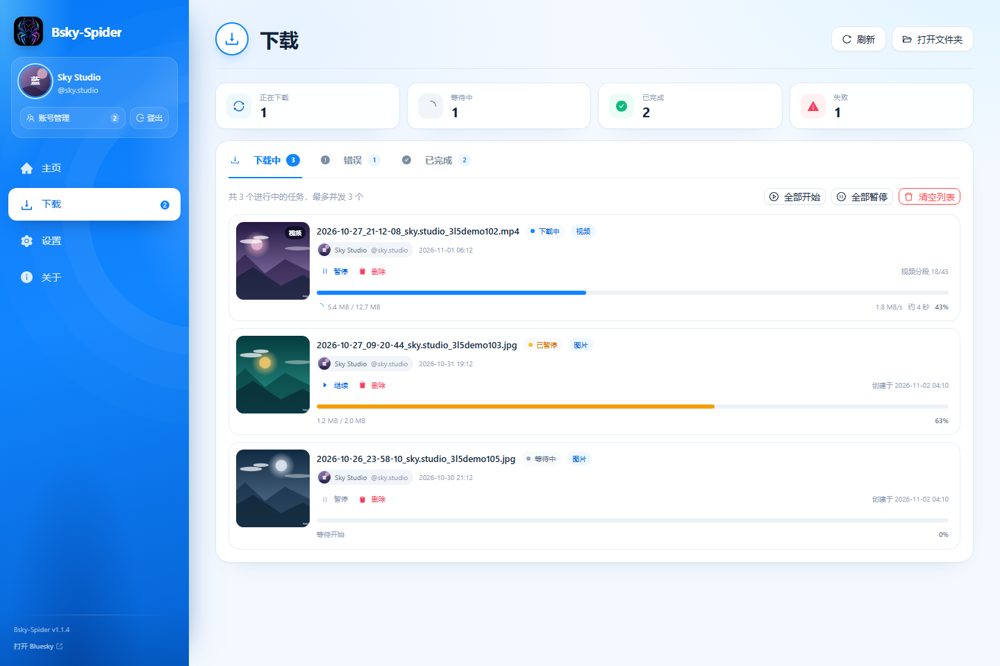 |

| 设置 | 关于 |
| --- | --- |
|  | 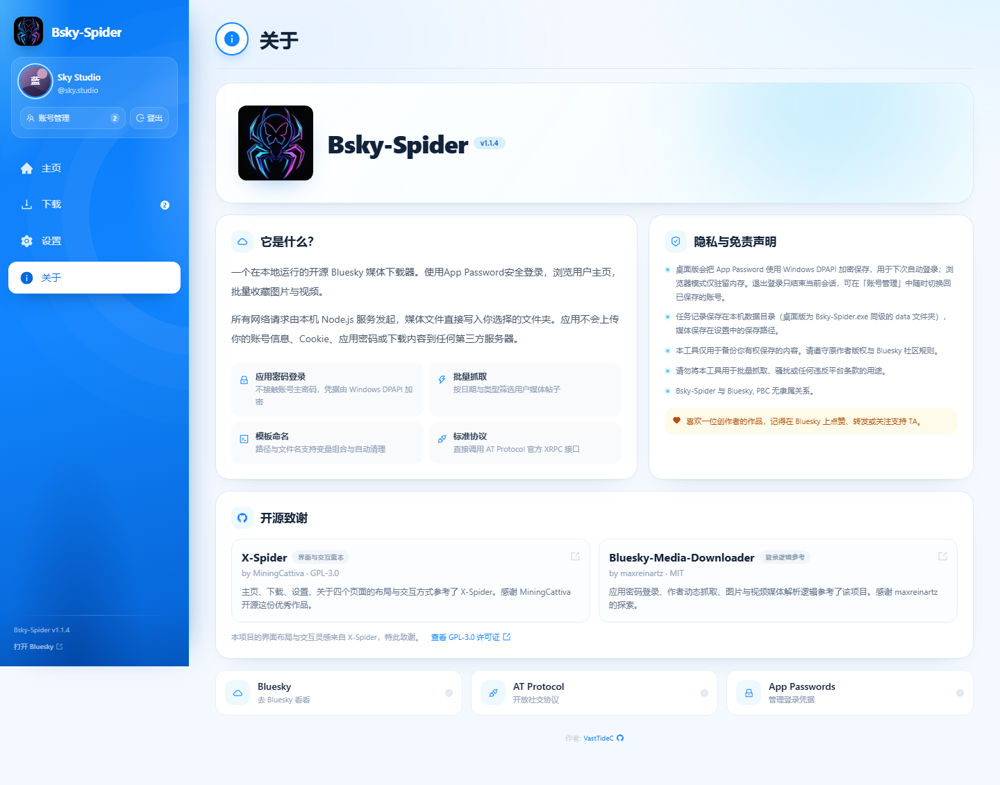 |

| 登录 | 未登录首页 |
| --- | --- |
| 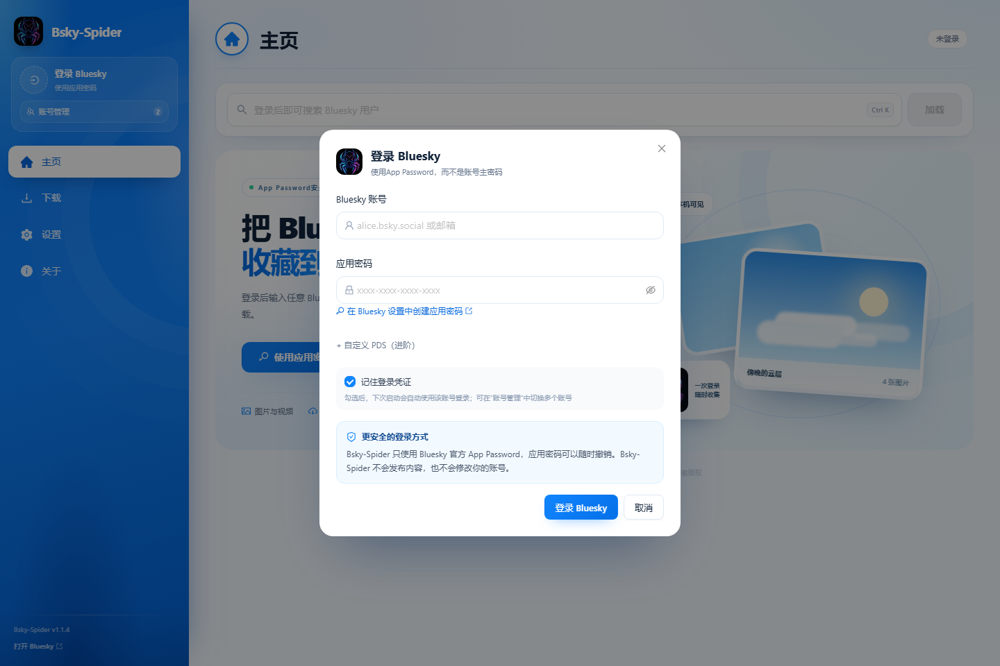 | 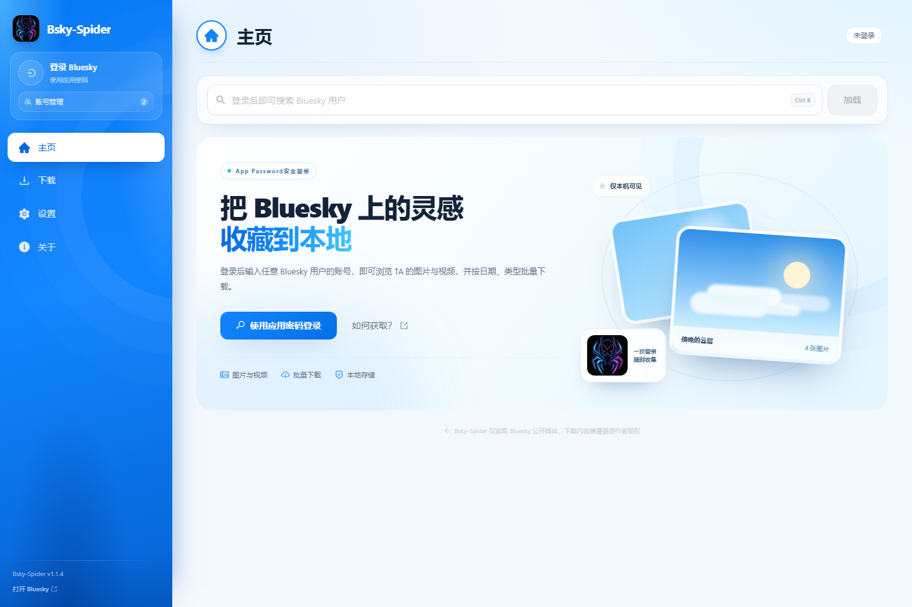 |

| 账号管理 |
| --- |
| 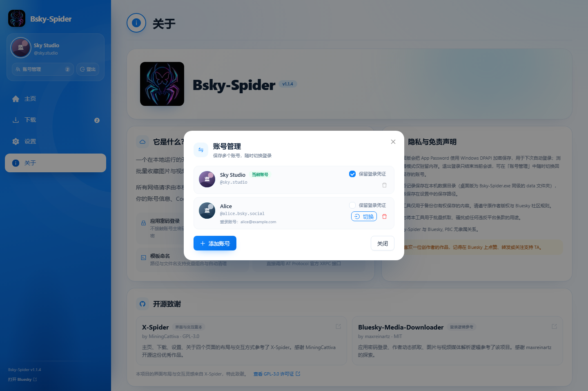 |

### 主题

| Bluesky（默认） | 暗黑 | 赛博朋克 |
| --- | --- | --- |
|  | 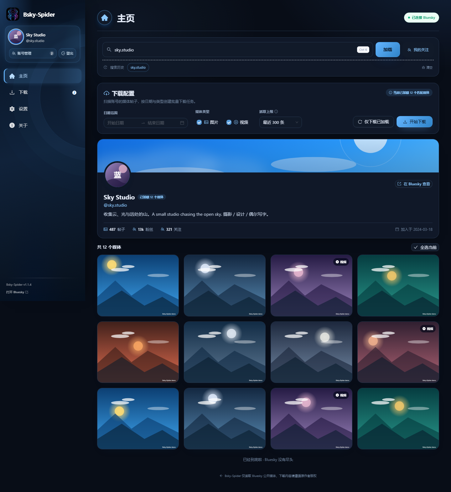 | 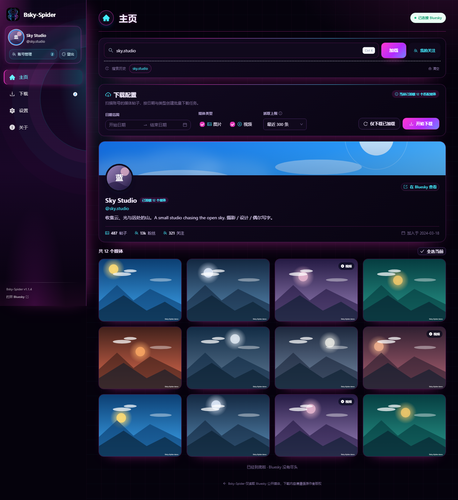 |

### 多语言

| 繁体中文 | Русский |
| --- | --- |
| 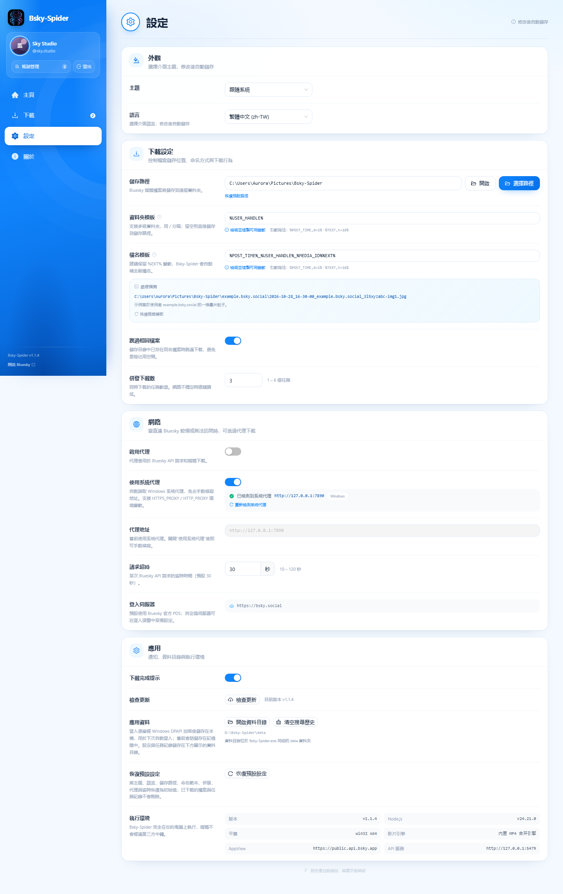 | 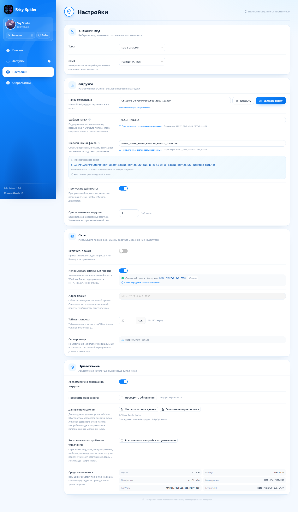 |

### 移动端布局

| 主页 | 设置 |
| --- | --- |
| 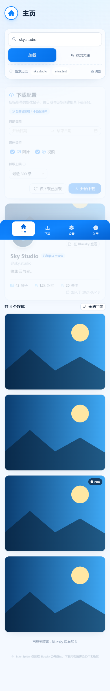 | 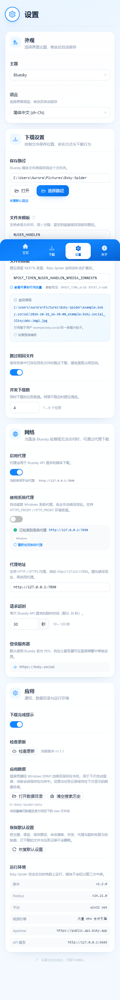 |

## 下载原理

### 1. 媒体从哪里来

| 媒体 | 优先来源 | 回退来源 |
| --- | --- | --- |
| 视频 | 作者 PDS 上的**原始上传 MP4**（`com.atproto.sync.getBlob`） | Bluesky HLS 转码流（最高档位） |
| 图片 | 作者 PDS 上的**原始 blob**（JPEG / PNG / WebP 等原始格式） | CDN `fullsize`（通常是 WebP） |

Bluesky 的 CDN 对图片做格式转换，对视频提供 HLS 转码（常见档位为 360p / 720p）。原始文件只存在于作者的 PDS 上，因此 Bsky-Spider 会：

1. 通过 `did:plc` / `did:web` 的 DID 文档解析作者 PDS 地址（带缓存，同一作者只解析一次）；
2. 用 `cid` 调用 `com.atproto.sync.getBlob` 取得原始文件；
3. 用响应 `Content-Type` 决定扩展名（`.mp4` / `.jpg` / `.png` / `.webp` / `.gif` / `.avif` 等）；
4. 只有原始文件返回错误、或返回的内容不是图片/视频时，才回退到 CDN / HLS，并在任务上标注「原始文件不可用，已回退到 Bluesky 转码版本」。

> 实测：同一条视频，原始文件可能是 1080×1920，而 HLS 最高档位是 720×1280。

### 2. 下载引擎

单文件下载由 `server/download-engine.ts` 负责，行为与 X-Spider 借助 aria2 多连接下载的思路一致：

1. 先用 `HEAD`（失败时退化为 1 字节 Range 请求）探测 `Content-Type`、`Content-Length` 与是否支持 `Range`；
2. 若服务器支持分段且文件 ≥ 2 MB，按 **最多 6 个连接**并行分段写入同一文件；
3. 若服务器不支持分段（Bluesky 的 PDS blob 端点即如此），退化为单连接流式写入；
4. 每次尝试失败自动重试，最多 3 次，退避 600 ms 起；HTTP 4xx 与内容类型错误不重试；
5. 临时文件保留在目标目录（`.bsky-<任务ID>.part`），服务器支持 `Range` 时继续下载会从断点续传；
6. 网络超时保护：连接 20 s、响应头 45 s、数据静默 90 s。

### 3. HLS 回退

1. 读取主播放列表，按 `BANDWIDTH` / `RESOLUTION` 选择最高档位；
2. 解析媒体播放列表：分片列表、`EXT-X-MAP` 初始化段、`EXT-X-KEY` 加密标记（加密流会直接报错，不保存无法播放的文件）；
3. 分片以 **4 路并发**下载到 `.bsky-<任务ID>.parts/`，完成后按顺序合并；中断后「继续下载」会复用已经下完的分片，播放列表变化时自动作废旧分片；
4. 若流是 fMP4（`EXT-X-MAP` + `.m4s`），初始化段 + 分片顺序拼接即为可播放 MP4；
5. 若流是 MPEG-TS（Bluesky 当前的转码格式），交由内置封装器处理。

### 4. 内置 MP4 合并引擎（替代 FFmpeg）

`server/remux/` 是一个只做「流复制」的 MPEG-TS → MP4 转换器，全部用 TypeScript 实现：

| 模块 | 职责 |
| --- | --- |
| `ts-demux.ts` | 解析 188 字节 TS 包、PAT/PMT、PES 头，提取 H.264 / AAC 基本流与 PTS/DTS |
| `h264.ts` | Annex B 拆分、SPS 解析（分辨率 / 帧率）、生成 `avcC`、把访问单元转成 MP4 样本 |
| `aac.ts` | ADTS 拆帧、生成 `AudioSpecificConfig` |
| `mp4-writer.ts` | 写 `ftyp` / `mdat` / `moov`（`mvhd`、`tkhd`、`mdhd`、`hdlr`、`stsd`、`avcC`、`esds`、`stts`、`ctts`、`stss`、`stsc`、`stsz`、`stco` 等） |
| `index.ts` | 时间轴归一化、音视频起点对齐、调用封装器输出 MP4 |

特点：

- **只复制，不重新编码**，画质与原流完全一致；
- 自动处理 33 位时间戳回绕与分片时间戳重启，音视频始终同步；
- 输出为渐进式 MP4（`moov` 在文件末尾），Chromium / Windows / 常见播放器都可直接播放；
- 转化失败时不会丢文件：保留 `.ts` 并在任务上提示「视频封装失败，已保留为 .ts 文件」；
- MP4 采用 faststart 布局（`moov` 在 `mdat` 之前），播放器与 Windows 资源管理器可以立即读取时长并生成封面缩略图。
- 只有在封装器无法解析该流（例如编码不是 H.264/AAC）时才会保留 `.ts`，任务上会明确标注。

## 安装与运行

### 方式一：ZIP 免安装版（推荐）

1. 从仓库下载 `Bsky-Spider-1.2.0-win-x64.zip`（或直接使用本机 `release/` 中的同名文件）并解压；
2. 进入 `Bsky-Spider` 文件夹，双击 **`Bsky-Spider.exe`**；
3. 无需安装，也无需 Node.js 或 FFmpeg。

SHA256（ZIP）：`3914EA8259D41FF04F3F349E3AB9CB8FDCBB4981411F28CE70BF01783DE5D8B0`

- 如果 Windows 提示「文件来自网络」，先右键 ZIP → 属性 → 勾选「解除锁定」，再解压；
- 不要在压缩包预览窗口中直接双击 exe；
- 启动失败时查看 exe 同级 `data\server.log`（不可写时为 `%APPDATA%\Bsky-Spider\data\server.log`）。

### 方式二：单文件便携版

`Bsky-Spider-1.2.0-portable.exe` 由 electron-builder 生成（仅本地构建产物，仓库只提供 ZIP），启动时解压到系统临时目录：

```bat
mkdir C:\Temp
set TEMP=C:\Temp
set TMP=C:\Temp
"X:\path\to\Bsky-Spider-1.2.0-portable.exe"
```

未做代码签名，首次运行可能出现 SmartScreen 提示（更多信息 → 仍要运行）。

### 方式三：从源码运行

需要 **Node.js 20 或更高版本**。

```bash
npm install
npm run build
npm start            # 打开 http://127.0.0.1:5179
```

Windows 也可以直接双击 **`start-bsky-spider.bat`**：脚本会安装依赖、构建并启动，然后打开浏览器。

开发模式（Vite 热更新 + API 服务）：

```bash
npm run dev
# UI:  http://127.0.0.1:5178
# API: http://127.0.0.1:5179
```

### 重新打包

```bash
npm run build:exe       # release/Bsky-Spider-1.2.0-portable.exe
npm run build:zip       # release/Bsky-Spider-1.2.0-win-x64.zip（含 win-unpacked 目录）
```

`build:zip` 内部会执行 `build:exe:dir`（生成 `release/win-unpacked`）与 `scripts/build-zip.ps1`。

## 登录与自动登录

1. 在 Bluesky 中打开 **Settings → App Passwords**（<https://bsky.app/settings/app-passwords>）；
2. 创建 App Password，复制形如 `xxxx-xxxx-xxxx-xxxx` 的凭据；
3. 在 Bsky-Spider 侧边栏点击 **登录 Bluesky**，填写 Handle（或邮箱）与 App Password；
4. 登录窗口可勾选 **记住登录凭证**（默认勾选）。

- 桌面版把账号、App Password 与可选的自定义 PDS 用 **Windows DPAPI** 加密后保存在 `<exe 同级>/data/accounts.enc`，下次启动自动登录；
- 自动登录失败（凭据被撤销、网络或代理不可用）时会打开登录窗口，并预填已保存的账号；
- 点击侧边栏 **账号管理** 可以在已保存的账号之间切换、添加或删除账号；每个账号的 App Password 都单独用 Windows DPAPI 加密保存；
- 在「账号管理」中可为每个账号独立勾选 **保留登录凭证**：当前账号已勾选时会在下次启动自动登录；取消勾选的账号会在下次启动前被移除（不再出现在账号管理中，也无法切换）；删除某个账号的凭证也可直接在「账号管理」中点删除；
- 点击 **登出** 会删除当前账号的登录凭证；若还有其他已保存账号，会自动切换并登录其中一个，否则进入完全登出状态（侧边栏只保留「登录 Bluesky」）；
- 浏览器 / 源码模式没有 Electron 安全存储，凭据只驻留内存，不会自动登录；
- 使用自建 PDS 时可在登录窗口展开「自定义 PDS（进阶）」填写地址，登录流程会自动校验 HTTPS。

## 使用流程

1. 主页输入用户 Handle（例如 `bsky.app`）并点击 **加载**；
2. 用日期范围、媒体类型、抓取上限筛选；网格可悬停预览、单独下载或打开原帖；
3. 勾选多个媒体后点 **下载所选**，或直接 **开始下载** 让服务端回扫该用户的媒体帖子；
4. 在 **下载** 查看进度，暂停 / 继续 / 重试 / 打开文件；
5. 在 **设置** 调整保存位置、模板、并发、代理等，修改后自动保存。

下载完成后，应用窗口顶部居中会显示约 **2 秒**的轻提示（多个任务合并计数），可在 **设置 → 应用 → 下载完成提示** 中关闭。

### 暂停与继续

- 暂停会立即中止当前连接；已写下的数据保留在临时文件中；
- 继续时会重新排队：原始文件下载会尽可能从断点续传（服务器支持 `Range` 时），HLS 回退会直接复用已经下载完成的分片；
- 重启应用后，未完成的任务会恢复为「等待」，可继续或删除。

## 文件命名模板

默认模板：

```text
文件夹：%USER_HANDLE%
文件名：%POST_TIME%_%USER_HANDLE%_%MEDIA_ID%%EXT%
```

可用变量：

| 变量 | 含义 |
| --- | --- |
| `%POST_ID%` | 帖子的 rkey |
| `%POST_TIME%` | 发布时间；`%POST_TIME,d=1%` 仅日期 |
| `%USER_HANDLE%` | 用户 Handle |
| `%USER_NAME%` | 用户昵称 |
| `%USER_DID%` | 用户 DID |
| `%MEDIA_ID%` | 媒体在帖子内的标识 |
| `%MEDIA_INDEX%` | 媒体在帖子中的序号（从 1 开始） |
| `%MEDIA_TYPE%` | `image` / `video` |
| `%MEDIA_WIDTH%` / `%MEDIA_HEIGHT%` | 媒体尺寸（如有） |
| `%TEXT%` | 帖子文本；`%TEXT,t=16%` 截断到 16 字符 |
| `%EXT%` | 扩展名（含点），按实际响应的内容类型自动修正 |

- 文件夹模板支持 `/` 分隔多级目录，留空则直接保存到保存路径；
- 变量值中的非法字符会被替换，Windows 保留文件名会被自动加前缀，避免路径穿越与覆盖；
- 「设置」中提供实时路径预览与一键恢复推荐模板。

## 设置项说明

| 分组 | 设置 | 说明 |
| --- | --- | --- |
| 外观 | 主题 | 跟随系统 / Bluesky / 暗黑 / 赛博朋克，系统主题变化时实时更新 |
| 外观 | 语言 | 跟随系统 / 简体中文 / 繁体中文 / 英语 / 俄语 |
| 存储 | 保存路径 | 媒体保存根目录，默认 `~/Downloads/Bsky-Spider`，可打开或重新选择 |
| 存储 | 文件夹模板 | 支持变量与多级目录 |
| 存储 | 文件名模板 | 支持变量，自动补全扩展名 |
| 下载 | 跳过相同文件 | 目标文件已存在时跳过（默认开启） |
| 下载 | 并发下载数 | 同时下载的任务数，1–6，默认 3 |
| 网络 | 启用代理 | 代理同时用于 Bluesky API 与媒体下载 |
| 网络 | 使用系统代理 | 自动读取 Windows 代理 / `HTTPS_PROXY` / `HTTP_PROXY`，也可关闭后手动填写 |
| 网络 | 代理地址 | 手动 HTTP/HTTPS 代理，例如 `http://127.0.0.1:7890` |
| 网络 | 请求超时 | 单次 Bluesky API 请求超时，10–120 秒，默认 30 |
| 应用 | 下载完成提示 | 窗口内轻提示开关，默认开启 |
| 应用 | 检查更新 | 读取 GitHub Releases 并与当前版本比较，可打开下载页面 |
| 应用 | 数据目录 | 显示当前数据目录，可一键打开 |
| 应用 | 恢复默认设置 | 一键恢复主题、语言、保存路径、模板、并发、代理与超时（不影响已下载文件与任务记录） |
| 应用 | 运行环境 | 版本、Node.js、平台、视频引擎、AppView、API 地址 |

内置 MP4 合并引擎随应用一起启动，始终启用，不依赖任何外部程序；设置页不再显示相关选项。

## 数据、隐私与安全

- 桌面版数据目录：**`Bsky-Spider.exe` 同级的 `data` 文件夹**——只要该文件夹存在就一定读取；仅在不存在且无法创建时才使用 `%APPDATA%\Bsky-Spider\data`；首次启动会自动迁移旧数据
- 浏览器 / 源码模式：项目下的 `data/`
- 设置 `settings.json`、任务记录 `tasks.json`、搜索历史 `history.json`（按账号 DID 分区保存）
- 自动登录凭据：`data/accounts.enc`（Windows DPAPI 加密，可保存多个账号）
- 运行日志：`data/server.log`
- 启动诊断：`%APPDATA%\Bsky-Spider\startup.log`（记录实际使用的数据目录与迁移结果）
- 当前会话：仅服务端内存 + HttpOnly Cookie
- 下载文件：设置中的保存路径，默认 `~/Downloads/Bsky-Spider`
- 服务只监听 `127.0.0.1`，不对局域网开放

应用不会发布内容、不会修改账号，也不会把账号信息、Cookie、App Password 或下载内容发送到任何第三方服务器。媒体请求由本机服务直接发往 Bluesky / 作者 PDS。

## 环境变量

| 变量 | 默认值 | 说明 |
| --- | --- | --- |
| `BSKY_SPIDER_PORT` | `5179` | API / 生产页面端口 |
| `BSKY_SPIDER_HOST` | `127.0.0.1` | 监听地址 |
| `BSKY_SPIDER_DATA_DIR` | `./data` | 设置与任务数据目录 |
| `BSKY_SPIDER_APPVIEW` | `https://public.api.bsky.app` | AppView 地址 |
| `BSKY_SPIDER_PDS` | `https://bsky.social` | 默认 PDS 登录地址 |
| `BSKY_SPIDER_OPEN` | 未设置 | 设为 `1` 启动后自动打开浏览器 |
| `BSKY_SPIDER_AUTO_LOGIN` | 未设置 | 私有：桌面主进程传给本地服务的一次性自动登录凭据 |

## 项目结构

```text
src/                  React 页面、组件、i18n 与 Zustand 状态
server/
  index.ts            Express API 与静态资源服务
  bsky.ts             Bluesky XRPC 客户端、媒体解析、Feed 抓取
  auth.ts             登录 / 会话 / 限流
  pds.ts              DID 文档解析、原始 blob URL
  downloads.ts        下载队列、任务状态、候选来源与回退
  download-engine.ts  单文件下载引擎（多连接 / 重试 / 续传）
  hls.ts              HLS 播放列表解析
  remux/              内置 MPEG-TS → MP4 封装器（替代 FFmpeg）
  proxy.ts            系统代理检测
  storage.ts          设置持久化
  http.ts             undici + 代理 + 超时封装
shared/               前后端共享类型与命名模板
electron/             Electron 主进程、preload、启动画面与 Logo
public/               界面 Logo、PWA manifest、许可证
build/                打包图标（icon.ico / icon-512.png）
scripts/              验证、UI 自动化与截图脚本
data/                 运行时生成（已 gitignore）
```

技术栈：

- 前端：React 18、TypeScript、Vite、Ant Design 5、Tailwind CSS、Zustand、Day.js
- 服务端：Node.js、Express、undici（HTTP/HTTPS 代理）、文件系统流式下载
- 媒体处理：项目内置 TypeScript H.264/AAC 解封装与 MP4 封装（无外部二进制）
- 协议：AT Protocol XRPC（`com.atproto.server.createSession`、`app.bsky.actor.getProfile`、`app.bsky.feed.getAuthorFeed`、`com.atproto.sync.getBlob`）

## 验证脚本

安装依赖并构建后运行。

```bash
npm run test             # TypeScript 类型检查
npm run test:original    # 真实网络：原始 JPEG/MP4 下载 + HLS 回退内置封装并校验 MP4 结构
npm run test:auth        # App Password 登录、JWT 刷新、Feed 媒体解析（本地 mock）
npm run test:server      # HTTP 登录 Cookie、会话、鉴权、批量下载、登出（本地 mock）
npm run test:download    # 图片 + HLS 分片合并；已完成文件缺失时重新下载
npm run test:pause       # 暂停、立即继续、Range 续传
npm run test:proxy       # 系统代理检测并通过代理访问 Bluesky（需要网络）
npm run test:proxy-auto  # 检测到系统代理时自动启用，且手动关闭后不被重置
npm run test:auto-login  # 自动登录与代理设置跨重启持久化
npm run test:history    # 搜索历史按账号隔离与旧数据迁移（本地）
```

UI 自动化与截图需要本机 Chrome / Edge，并且先启动生产服务：

```bash
npm start
# 另一个终端
npm run test:ui      # 登录、搜索、预览、下载、设置保存、关于、移动端布局
npm run screenshot   # 生成 screenshots/*.png（使用模拟数据）
```

`test:original` 会：

1. 从真实帖子下载图片与视频的原始 blob，校验 JPEG 魔数与 MP4 `ftyp/moov`；
2. 对同一条视频强制走 HLS 回退，校验输出为带 `moov` / `mdat` / `avcC` 的 MP4，并检查时长；
3. 用一个多分片、带音频的视频校验音轨被正确写入（`mp4a`），并与源分片 PMT 中的音频流对照。

## 常见问题

**Q：还需要安装 FFmpeg 吗？**

不需要。1.0.0 起应用不包含也不调用 FFmpeg，HLS 转封装由内置 TypeScript 引擎完成，并且总是输出 MP4。

**Q：为什么有的视频只有 720p？**

Bluesky 的 HLS 转码通常只提供 360p / 720p 档位。Bsky-Spider 会优先下载作者 PDS 上的原始 MP4（例如 1080×1920）；只有原始文件被清理时才会落到 HLS 档位，并在任务上标注。

**Q：下载的图片是 WebP，不是原图？**

说明该帖子的原始 blob 已不可用，回退到了 CDN 的 `fullsize`，CDN 统一返回 WebP。原始 blob 可用时会保存为 JPEG / PNG。

**Q：为什么任务失败提示「原始文件不可用」？**

作者 PDS 上的 blob 可能已被删除或该 PDS 不允许匿名读取，此时会自动回退到转码版本；回退成功时任务仍会显示完成，只是带备注。

**Q：代理怎么设置？**

程序启动时会自动检测 Windows 系统代理（也支持 `HTTPS_PROXY` / `HTTP_PROXY`），检测到时会自动开启；若系统代理没有被识别（PAC 或仅 SOCKS 的情况），在设置中关闭「使用系统代理」并填写 HTTP/HTTPS 代理地址即可。

**Q：自动登录失败怎么办？**

打开登录窗口重新输入即可；勾选「记住登录凭证」会更新保存的凭据。如需删除本地凭据，可在「账号管理」中删除对应账号，或取消其「保留登录凭证」勾选后重启。

**Q：下载到一半崩溃了会丢进度吗？**

不会丢文件。未完成的任务会保留为「等待/暂停」，临时文件保存在目标目录；HLS 回退已完成的分片会在继续时复用。

## 已知限制

- 只读取用户作者 Feed 中的媒体帖子，不提供搜索、点赞、书签或私密内容下载。
- Bluesky / AppView 的速率限制可能导致批量抓取失败，请降低扫描上限或稍后重试。
- 原始 blob 需要作者 PDS 公开可读；若 PDS 拒绝匿名访问或未部署 sync 接口，会回退到 CDN / HLS 转码版本。
- 内置封装器支持 H.264 视频 + AAC 音频（Bluesky 当前全部转码流均为该组合）；其他编码（如 HEVC）会保留 `.ts` 并提示。
- 受 DRM / 加密保护的 HLS 流不支持下载。
- 自动登录仅在 Windows 桌面版可用；浏览器模式不会保存 App Password。
- 本项目不是 Bluesky 官方客户端，与 Bluesky, PBC 无隶属关系。

## 更新日志

- **1.2.0**：项目上传至 GitHub（vasttidec/Bsky-Spider），检查更新接入 GitHub Releases，README 拆分为 English / 简体中文 / 繁體中文 / Русский 四个版本。
- **1.1.5**：取消保留凭证的账号在重启后移除；登出会删除当前账号并自动切换到其他已保存账号，无其他账号时隐藏「账号管理」；检查更新提示改为「当前已经是最新版本」。
- **1.1.4**：当前账号未保留凭证时重启自动切换到其他已勾选账号；「删除登录凭据」改为「删除登录凭证」并同步多语言；账号管理勾选项与删除按钮右对齐；移除检查更新说明文本。
- **1.1.3**：「自动登录」改为「保存登录凭证」并支持每账号独立勾选；侧边栏账号面板适配暗黑/赛博朋克主题；关于页移除版本号文本；设置新增「检查更新」入口（暂未关联 GitHub）。
- **1.1.2**：下载完成提示默认开启；默认保存路径改用系统真实 Downloads 文件夹；添加账号时不再显示已登录账号的凭据；关于页文案调整；路径预览左对齐；账号管理新增「自动登录」勾选并移除设置中的「清除自动登录」；侧边栏加宽修复英文/俄文截断。
- **1.1.1**：登出后保持未登录状态（保留账号以便切换）；搜索历史按账号隔离；重复登录同一账号时提示「当前账号已经登录」；登录页说明文字与图标对齐。
- **1.1.0**：账号管理显示头像并区分昵称、handle 与登录账号；隐藏设置中的视频封装项（引擎始终启用）；修复 exe 同级 `data` 文件夹在旧数据存在时不被读取的问题，新增启动诊断日志；侧边栏删除登录状态文本，登出按钮移到账号管理右侧并更名。
- **1.0.1**：移除「HLS 视频转封装」开关，HLS 回退流统一封装为 faststart MP4（封面缩略图可用、提示与实际格式一致）；原始文件仅在确认不可用时才回退，避免临时网络错误降低画质；「请求超时」设置真正生效且默认 30 秒；新增多账号管理与切换；数据目录改为 exe 同级 `data` 并自动迁移；设置新增「恢复默认设置」；「下载管理」更名为「下载」；登录窗口、主页、关于页文案调整。
- **1.0.0**：重构下载逻辑，移除 FFmpeg 依赖，视频原画质与 HLS 回退全部改为内置实现；新增多连接分段下载、请求重试、HLS 分片并行与断点复用；替换全新 Logo；版本号统一为 1.0.0；文档全部重写。
- **1.9.x 及更早**：历史版本，细节不再维护（重构前的版本说明未保留备份）。

## 开源致谢与许可

- 界面与交互蓝本、下载思路参考：[X-Spider](https://github.com/MiningCattiva/x-spider) by [MiningCattiva](https://github.com/MiningCattiva)（GPL-3.0）
- App Password 登录与媒体抓取参考：[Bluesky-Media-Downloader](https://github.com/maxreinartz/Bluesky-Media-Downloader) by [maxreinartz](https://github.com/maxreinartz)（MIT）
- 内置 MP4 合并引擎：本项目自行实现，仅做流复制，不包含 FFmpeg 代码

Bsky-Spider 以 **GPL-3.0-only** 发布，完整文本见 [LICENSE](LICENSE)。请尊重原作者版权与 Bluesky 社区规则，仅下载你有权保存的内容。
