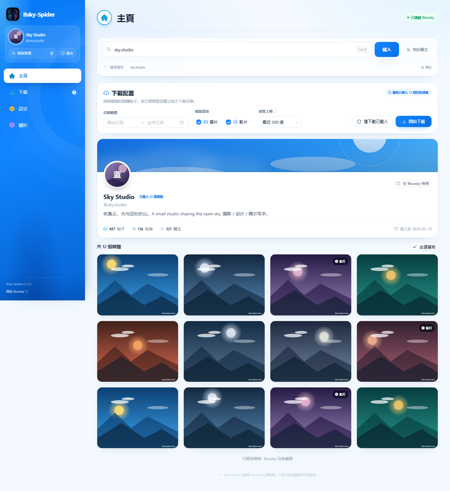

# Bsky-Spider

[English](README.md) | [简体中文](README.zh-CN.md) | **繁體中文** | [Русский](README.ru.md)

**Bluesky 媒體下載器**

> 目前版本：1.2.5
> 下載連結：https://github.com/vasttidec/Bsky-Spider/releases/tag/v1.2.5

Bsky-Spider 以 DeepSeek Harness 為框架，全程使用模型 DeepSeek-V4.1-Flash-1017 構建，推理等級配置為 Max。

Bsky-Spider 是一個完全在本機執行的 Bluesky 圖片與影片下載工具：使用 **App Password** 安全登入，瀏覽任意使用者的媒體貼文，依日期與類型批次下載，並盡可能儲存**原始檔案**而不是轉碼版本。介面沿用歷代版本的四頁結構（首頁 / 下載 / 設定 / 關於），互動藍本來自 [X-Spider](https://github.com/MiningCattiva/x-spider)。



## 目錄

- [功能](#功能)
- [下載原理](#下載原理)
- [安裝與執行](#安裝與執行)
- [登入與自動登入](#登入與自動登入)
- [使用流程](#使用流程)
- [檔案命名範本](#檔案命名範本)
- [設定項說明](#設定項說明)
- [資料、隱私與安全](#資料隱私與安全)
- [環境變數](#環境變數)
- [專案結構](#專案結構)
- [驗證腳本](#驗證腳本)
- [常見問題](#常見問題)
- [已知限制](#已知限制)
- [免責聲明](#免責聲明)
- [更新日誌](#更新日誌)
- [開源致謝與授權](#開源致謝與授權)

## 功能

- **App Password 登入**：不接觸帳號主密碼；可勾選「記住登入憑證」，桌面版用 Windows DPAPI 加密儲存，下次啟動自動登入。
- **搜尋使用者**：支援 Handle、`@handle`、DID，或直接貼上 `https://bsky.app/profile/...` 連結。
- **我的追蹤**：讀取目前帳號的追蹤清單，點選任意使用者即可跳到 TA 的媒體首頁。
- **媒體瀏覽**：擷取使用者媒體貼文，自動解析圖片、影片以及引用貼（`recordWithMedia`）裡的媒體，以格狀預覽並支援無限捲動。
- **搜尋紀錄**：最近搜尋的帳號儲存在本機資料目錄，重新啟動後仍可直接點選。
- **篩選與批次下載**：依日期範圍、圖片/影片類型、掃描上限（100/300/500/1000/全部）建立任務；支援單筆下載、下載所選、一次下載目前篩選結果。
- **下載**：下載中 / 錯誤 / 已完成三個分頁，即時進度、速度、ETA；支援暫停、繼續、重試、刪除、開啟檔案、開啟所在資料夾。
- **原始畫質優先**：影片與圖片都優先透過作者 PDS 的 `com.atproto.sync.getBlob` 下載原始 blob（原始 MP4 / JPEG / PNG），而不是 CDN 的 WebP 圖片或 HLS 轉碼影片。
- **免 FFmpeg 的影片合併**：HLS 回退流由內建 TypeScript 封裝器無損轉成 MP4（僅複製影音流，不重新編碼）。
- **帳號管理**：可儲存多個帳號（App Password 由 Windows DPAPI 加密），側邊欄一鍵切換；清單顯示頭像、暱稱與完整 handle，並可為每個帳號獨立勾選「保留登入憑證」。
- **多主題**：跟隨系統 / Bluesky / 暗黑 / 賽博龐克。
- **多語言**：系統語言、简体中文 (zh-CN)、繁體中文 (zh-TW)、英語 (en-US)、俄語 (ru-RU)。
- **代理支援**：自動讀取 Windows 系統代理或 `HTTPS_PROXY` / `HTTP_PROXY` 環境變數，也可手動填寫 HTTP/HTTPS 代理。
- **可設定**：儲存路徑、資料夾範本、檔名範本、略過同名檔案、並行數、請求逾時、下載完成提示，並可一鍵回復預設設定。
- **隱私**：所有請求由本機 Node.js 服務發起，媒體直接寫入本機資料夾，不上傳帳號或下載內容。

## 下載原理

### 1. 媒體從哪裡來

| 媒體 | 優先來源 | 回退來源 |
| --- | --- | --- |
| 影片 | 作者 PDS 上的**原始上傳 MP4**（`com.atproto.sync.getBlob`） | Bluesky HLS 轉碼流（最高層級） |
| 圖片 | 作者 PDS 上的**原始 blob**（JPEG / PNG / WebP 等原始格式） | CDN `fullsize`（通常是 WebP） |

Bluesky 的 CDN 對圖片做格式轉換，對影片提供 HLS 轉碼（常見層級為 360p / 720p）。原始檔案只存在於作者的 PDS 上，因此 Bsky-Spider 會：

1. 透過 `did:plc` / `did:web` 的 DID 文件解析作者 PDS 位址（帶快取，同一作者只解析一次）；
2. 用 `cid` 呼叫 `com.atproto.sync.getBlob` 取得原始檔案；
3. 用回應 `Content-Type` 決定副檔名（`.mp4` / `.jpg` / `.png` / `.webp` / `.gif` / `.avif` 等）；
4. 只有原始檔案傳回錯誤、或傳回的內容不是圖片/影片時，才回退到 CDN / HLS，並在任務上標註「原始檔案不可用，已回退到 Bluesky 轉碼版本」。

> 實測：同一條影片，原始檔案可能是 1080×1920，而 HLS 最高層級是 720×1280。

### 2. 下載引擎

單檔下載由 `server/download-engine.ts` 負責，行為與 X-Spider 藉助 aria2 多連線下載的思路一致：

1. 先用 `HEAD`（失敗時退化為 1 位元組 Range 請求）探測 `Content-Type`、`Content-Length` 與是否支援 `Range`；
2. 若伺服器支援分段且檔案 ≥ 2 MB，依 **最多 6 個連線**並行分段寫入同一檔案；
3. 若伺服器不支援分段（Bluesky 的 PDS blob 端點即如此），退化為單一連線串流寫入；
4. 每次嘗試失敗自動重試，最多 3 次，退避 600 ms 起；HTTP 4xx 與內容類型錯誤不重試；
5. 暫存檔保留在目標目錄（`.bsky-<任務ID>.part`），伺服器支援 `Range` 時繼續下載會從斷點續傳；
6. 網路逾時保護：連線 20 s、回應標頭 45 s、資料無回應 90 s。

### 3. HLS 回退

1. 讀取主播放清單，依 `BANDWIDTH` / `RESOLUTION` 選擇最高層級；
2. 解析媒體播放清單：分片清單、`EXT-X-MAP` 初始化區段、`EXT-X-KEY` 加密標記（加密流會直接報錯，不儲存無法播放的檔案）；
3. 分片以 **4 路並行**下載到 `.bsky-<任務ID>.parts/`，完成後依序合併；中斷後「繼續下載」會沿用已經下載完成的分片，播放清單變化時自動作廢舊分片；
4. 若流是 fMP4（`EXT-X-MAP` + `.m4s`），初始化區段 + 分片順序拼接即為可播放 MP4；
5. 若流是 MPEG-TS（Bluesky 目前的轉碼格式），交由內建封裝器處理。

### 4. 內建 MP4 合併引擎（替代 FFmpeg）

`server/remux/` 是一個只做「流複製」的 MPEG-TS → MP4 轉換器，全部用 TypeScript 實作：

| 模組 | 職責 |
| --- | --- |
| `ts-demux.ts` | 解析 188 位元組 TS 封包、PAT/PMT、PES 標頭，提取 H.264 / AAC 基本流與 PTS/DTS |
| `h264.ts` | Annex B 拆分、SPS 解析（解析度 / 幀率）、產生 `avcC`、把存取單元轉成 MP4 樣本 |
| `aac.ts` | ADTS 拆幀、產生 `AudioSpecificConfig` |
| `mp4-writer.ts` | 寫入 `ftyp` / `mdat` / `moov`（`mvhd`、`tkhd`、`mdhd`、`hdlr`、`stsd`、`avcC`、`esds`、`stts`、`ctts`、`stss`、`stsc`、`stsz`、`stco` 等） |
| `index.ts` | 時間軸正規化、影音起點對齊、呼叫封裝器輸出 MP4 |

特點：

- **只複製，不重新編碼**，畫質與原始流完全一致；
- 自動處理 33 位元時間戳回繞與分片時間戳重啟，影音始終同步；
- 輸出為漸進式 MP4（`moov` 在檔案末尾），Chromium / Windows / 常見播放器都可直接播放；
- 轉換失敗時不會遺失檔案：保留 `.ts` 並在任務上提示「影片封裝失敗，已保留為 .ts 檔案」；
- MP4 採用 faststart 配置（`moov` 在 `mdat` 之前），播放器與 Windows 檔案總管可以立即讀取時長並產生封面縮圖。
- 只有在封裝器無法解析該流（例如編碼不是 H.264/AAC）時才會保留 `.ts`，任務上會明確標註。

## 安裝與執行

### 方式一：ZIP 免安裝版（推薦）

1. 從儲存庫下載 `Bsky-Spider-1.2.5-win-x64.zip`（或直接使用本機 `release/` 中的同名檔案）並解壓縮；
2. 進入 `Bsky-Spider` 資料夾，雙擊 **`Bsky-Spider.exe`**；
3. 無需安裝，也無需 Node.js 或 FFmpeg。

SHA256（ZIP）：`4069D3F8037BF166FEDC0BE9F21EB9850D1CFC38005FC51A2AC2C13E37003F6B`

- 如果 Windows 提示「檔案來自網路」，先右鍵 ZIP → 內容 → 勾選「解除封鎖」，再解壓縮；
- 不要在壓縮檔預覽視窗中直接雙擊 exe；
- 啟動失敗時查看 exe 同層 `data\server.log`（不可寫入時為 `%APPDATA%\Bsky-Spider\data\server.log`）。

### 其他安裝套件

- **Windows 安裝程式**：`Bsky-Spider-1.2.5-win-x64-setup.exe`，預設安裝到 `C:\Program Files\Bsky-Spider`（全機安裝，需要系統管理員權限），安裝最後一頁可選擇建立桌面捷徑與立即啟動。
- **Linux**：`Bsky-Spider-1.2.5.AppImage` 與 `Bsky-Spider-1.2.5.deb`（x64），預設下載目錄為 `~/Downloads/Bsky-Spider`。

### 方式二：從原始碼執行

需要 **Node.js 20 或更高版本**。

```bash
npm install
npm run build
npm start            # 開啟 http://127.0.0.1:5179
```

Windows 也可以直接雙擊 **`start-bsky-spider.bat`**：腳本會安裝相依套件、建置並啟動，然後開啟瀏覽器。

開發模式（Vite 熱更新 + API 服務）：

```bash
npm run dev
# UI:  http://127.0.0.1:5178
# API: http://127.0.0.1:5179
```

### 重新打包

```bash
npm run build:exe       # release/Bsky-Spider-1.2.5-portable.exe
npm run build:zip       # release/Bsky-Spider-1.2.5-win-x64.zip（含 win-unpacked 目錄）
```

`build:zip` 內部會執行 `build:exe:dir`（產生 `release/win-unpacked`）與 `scripts/build-zip.ps1`。

## 登入與自動登入

1. 在 Bluesky 中開啟 **Settings → App Passwords**（<https://bsky.app/settings/app-passwords>）；
2. 建立 App Password，複製形如 `xxxx-xxxx-xxxx-xxxx` 的憑證；
3. 在 Bsky-Spider 側邊欄點擊 **登入 Bluesky**，填寫 Handle（或電子郵件）與 App Password；
4. 登入視窗可勾選 **記住登入憑證**（預設勾選）。

- 桌面版把帳號、App Password 與可選的自訂 PDS 用 **Windows DPAPI** 加密後儲存在 `<exe 同層>/data/accounts.enc`，下次啟動自動登入；
- 自動登入失敗（憑證被撤銷、網路或代理不可用）時會開啟登入視窗，並預填已儲存的帳號；
- 點擊側邊欄 **帳號管理** 可以在已儲存的帳號之間切換、新增或刪除帳號；每個帳號的 App Password 都單獨用 Windows DPAPI 加密儲存；
- 在「帳號管理」中可為每個帳號獨立勾選 **保留登入憑證**：目前帳號已勾選時會在下次啟動自動登入；取消勾選的帳號會在下次啟動前被移除（不再出現在帳號管理中，也無法切換）；刪除某個帳號的憑證也可直接在「帳號管理」中點刪除；
- 點擊 **登出** 會刪除目前帳號的登入憑證；若還有其他已儲存帳號，會自動切換並登入其中一個，否則進入完全登出狀態（側邊欄只保留「登入 Bluesky」）；
- 瀏覽器 / 原始碼模式沒有 Electron 安全儲存，憑證只駐留記憶體，不會自動登入；
- 使用自建 PDS 時可在登入視窗展開「自訂 PDS（進階）」填寫位址，登入流程會自動驗證 HTTPS。

## 使用流程

1. 首頁輸入使用者 Handle（例如 `bsky.app`）並點擊 **載入**；
2. 用日期範圍、媒體類型、擷取上限篩選；格狀清單可懸停預覽、單獨下載或開啟原貼文；
3. 勾選多個媒體後點 **下載所選**，或直接 **開始下載** 讓伺服器端回掃該使用者的媒體貼文；
4. 在 **下載** 查看進度，暫停 / 繼續 / 重試 / 開啟檔案；
5. 在 **設定** 調整儲存位置、範本、並行、代理等，修改後自動儲存。

下載完成後，應用程式視窗頂部置中會顯示約 **2 秒**的輕提示（多個任務合併計數），可在 **設定 → 應用 → 下載完成提示** 中關閉。

### 暫停與繼續

- 暫停會立即中止目前連線；已寫入的資料保留在暫存檔中；
- 繼續時會重新排入佇列：原始檔案下載會盡可能從斷點續傳（伺服器支援 `Range` 時），HLS 回退會直接沿用已經下載完成的分片；
- 重新啟動應用程式後，未完成的任務會恢復為「等待」，可繼續或刪除。

## 檔案命名範本

預設範本：

```text
資料夾：%USER_HANDLE%
檔名：%POST_TIME%_%USER_HANDLE%_%MEDIA_ID%%EXT%
```

可用變數：

| 變數 | 含義 |
| --- | --- |
| `%POST_ID%` | 貼文的 rkey |
| `%POST_TIME%` | 發佈時間；`%POST_TIME,d=1%` 僅日期 |
| `%USER_HANDLE%` | 使用者 Handle |
| `%USER_NAME%` | 使用者暱稱 |
| `%USER_DID%` | 使用者 DID |
| `%MEDIA_ID%` | 媒體在貼文內的識別 |
| `%MEDIA_INDEX%` | 媒體在貼文中的序號（從 1 開始） |
| `%MEDIA_TYPE%` | `image` / `video` |
| `%MEDIA_WIDTH%` / `%MEDIA_HEIGHT%` | 媒體尺寸（如有） |
| `%TEXT%` | 貼文文字；`%TEXT,t=16%` 截斷到 16 字元 |
| `%EXT%` | 副檔名（含點），依實際回應的內容類型自動修正 |

- 資料夾範本支援 `/` 分隔多層目錄，留空則直接儲存到儲存路徑；
- 變數值中的非法字元會被替換，Windows 保留檔名會自動加上前綴，避免路徑穿越與覆寫；
- 「設定」中提供即時路徑預覽與一鍵回復建議範本。

## 設定項說明

| 分組 | 設定 | 說明 |
| --- | --- | --- |
| 外觀 | 主題 | 跟隨系統 / Bluesky / 暗黑 / 賽博龐克，系統主題變化時即時更新 |
| 外觀 | 語言 | 跟隨系統 / 简体中文 / 繁體中文 / 英語 / 俄語 |
| 儲存 | 儲存路徑 | 媒體儲存根目錄，預設 `~/Downloads/Bsky-Spider`，可開啟或重新選擇 |
| 儲存 | 資料夾範本 | 支援變數與多層目錄 |
| 儲存 | 檔名範本 | 支援變數，自動補齊副檔名 |
| 下載 | 略過相同檔案 | 目標檔案已存在時略過（預設開啟） |
| 下載 | 並行下載數 | 同時下載的任務數，1–6，預設 3 |
| 網路 | 啟用代理 | 代理同時用於 Bluesky API 與媒體下載 |
| 網路 | 使用系統代理 | 自動讀取 Windows 代理 / `HTTPS_PROXY` / `HTTP_PROXY`，也可關閉後手動填寫 |
| 網路 | 代理位址 | 手動 HTTP/HTTPS 代理，例如 `http://127.0.0.1:7890` |
| 網路 | 請求逾時 | 單次 Bluesky API 請求逾時，10–120 秒，預設 30 |
| 應用 | 下載完成提示 | 視窗內輕提示開關，預設開啟 |
| 應用 | 檢查更新 | 讀取 GitHub Releases 並與目前版本比較，可開啟下載頁面 |
| 應用 | 資料目錄 | 顯示目前資料目錄，可一鍵開啟 |
| 應用 | 回復預設設定 | 一鍵回復主題、語言、儲存路徑、範本、並行、代理與逾時（不影響已下載檔案與任務紀錄） |
| 應用 | 執行環境 | 版本、Node.js、平台、影片引擎、AppView、API 位址 |

內建 MP4 合併引擎隨應用程式一起啟動，始終啟用，不依賴任何外部程式；設定頁不再顯示相關選項。

## 資料、隱私與安全

- 桌面版資料目錄：**`Bsky-Spider.exe` 同層的 `data` 資料夾**——只要該資料夾存在就一定讀取；僅在不存在且無法建立時才使用 `%APPDATA%\Bsky-Spider\data`；首次啟動會自動移轉舊資料
- 瀏覽器 / 原始碼模式：專案下的 `data/`
- 設定 `settings.json`、任務紀錄 `tasks.json`、搜尋紀錄 `history.json`（依帳號 DID 分區儲存）
- 自動登入憑證：`data/accounts.enc`（Windows DPAPI 加密，可儲存多個帳號）
- 執行日誌：`data/server.log`
- 啟動診斷：`%APPDATA%\Bsky-Spider\startup.log`（記錄實際使用的資料目錄與移轉結果）
- 目前工作階段：僅伺服器端記憶體 + HttpOnly Cookie
- 下載檔案：設定中的儲存路徑，預設 `~/Downloads/Bsky-Spider`
- 服務只監聽 `127.0.0.1`，不對區域網路開放

應用程式不會發佈內容、不會修改帳號，也不會把帳號資訊、Cookie、App Password 或下載內容傳送到任何第三方伺服器。媒體請求由本機服務直接發往 Bluesky / 作者 PDS。

## 環境變數

| 變數 | 預設值 | 說明 |
| --- | --- | --- |
| `BSKY_SPIDER_PORT` | `5179` | API / 正式環境頁面連接埠 |
| `BSKY_SPIDER_HOST` | `127.0.0.1` | 監聽位址 |
| `BSKY_SPIDER_DATA_DIR` | `./data` | 設定與任務資料目錄 |
| `BSKY_SPIDER_APPVIEW` | `https://public.api.bsky.app` | AppView 位址 |
| `BSKY_SPIDER_PDS` | `https://bsky.social` | 預設 PDS 登入位址 |
| `BSKY_SPIDER_OPEN` | 未設定 | 設為 `1` 啟動後自動開啟瀏覽器 |
| `BSKY_SPIDER_AUTO_LOGIN` | 未設定 | 私有：桌面主行程傳給本機服務的一次性自動登入憑證 |

## 專案結構

```text
src/                  React 頁面、元件、i18n 與 Zustand 狀態
server/
  index.ts            Express API 與靜態資源服務
  bsky.ts             Bluesky XRPC 用戶端、媒體解析、Feed 擷取
  auth.ts             登入 / 工作階段 / 速率限制
  pds.ts              DID 文件解析、原始 blob URL
  downloads.ts        下載佇列、任務狀態、候選來源與回退
  download-engine.ts  單檔下載引擎（多連線 / 重試 / 續傳）
  hls.ts              HLS 播放清單解析
  remux/              內建 MPEG-TS → MP4 封裝器（替代 FFmpeg）
  proxy.ts            系統代理偵測
  storage.ts          設定持久化
  http.ts             undici + 代理 + 逾時封裝
shared/               前後端共用型別與命名範本
electron/             Electron 主行程、preload、啟動畫面與 Logo
public/               介面 Logo、PWA manifest、授權條款
build/                打包圖示（icon.ico / icon-512.png）
scripts/              驗證、UI 自動化與截圖腳本
data/                 執行時產生（已 gitignore）
```

技術棧：

- 前端：React 18、TypeScript、Vite、Ant Design 5、Tailwind CSS、Zustand、Day.js
- 伺服器端：Node.js、Express、undici（HTTP/HTTPS 代理）、檔案系統串流下載
- 媒體處理：專案內建 TypeScript H.264/AAC 解封裝與 MP4 封裝（無外部二進位檔）
- 協定：AT Protocol XRPC（`com.atproto.server.createSession`、`app.bsky.actor.getProfile`、`app.bsky.feed.getAuthorFeed`、`com.atproto.sync.getBlob`）

## 驗證腳本

安裝相依套件並建置後執行。

```bash
npm run test             # TypeScript 型別檢查
npm run test:original    # 真實網路：原始 JPEG/MP4 下載 + HLS 回退內建封裝並驗證 MP4 結構
npm run test:auth        # App Password 登入、JWT 更新、Feed 媒體解析（本機 mock）
npm run test:server      # HTTP 登入 Cookie、工作階段、驗證、批次下載、登出（本機 mock）
npm run test:download    # 圖片 + HLS 分片合併；已完成檔案遺失時重新下載
npm run test:pause       # 暫停、立即繼續、Range 續傳
npm run test:proxy       # 系統代理偵測並透過代理存取 Bluesky（需要網路）
npm run test:proxy-auto  # 偵測到系統代理時自動啟用，且手動關閉後不被重設
npm run test:auto-login  # 自動登入與代理設定跨重新啟動持久化
npm run test:history    # 搜尋紀錄依帳號隔離與舊資料移轉（本機）
```

UI 自動化與截圖需要本機 Chrome / Edge，並且先啟動正式環境服務：

```bash
npm start
# 另一個終端機
npm run test:ui      # 登入、搜尋、預覽、下載、設定儲存、關於、行動版版面
npm run screenshot   # 產生 screenshots/*.png（使用模擬資料）
```

`test:original` 會：

1. 從真實貼文下載圖片與影片的原始 blob，驗證 JPEG 魔術數字與 MP4 `ftyp/moov`；
2. 對同一條影片強制走 HLS 回退，驗證輸出為帶 `moov` / `mdat` / `avcC` 的 MP4，並檢查時長；
3. 用一個多分片、帶音訊的影片驗證音軌被正確寫入（`mp4a`），並與來源分片 PMT 中的音訊流比對。

## 常見問題

**Q：還需要安裝 FFmpeg 嗎？**

不需要。1.0.0 起應用程式不包含也不呼叫 FFmpeg，HLS 轉封裝由內建 TypeScript 引擎完成，並且總是輸出 MP4。

**Q：為什麼有的影片只有 720p？**

Bluesky 的 HLS 轉碼通常只提供 360p / 720p 層級。Bsky-Spider 會優先下載作者 PDS 上的原始 MP4（例如 1080×1920）；只有原始檔案被清理時才會落到 HLS 層級，並在任務上標註。

**Q：下載的圖片是 WebP，不是原圖？**

說明該貼文的原始 blob 已不可用，回退到了 CDN 的 `fullsize`，CDN 統一傳回 WebP。原始 blob 可用時會儲存為 JPEG / PNG。

**Q：為什麼任務失敗提示「原始檔案不可用」？**

作者 PDS 上的 blob 可能已被刪除或該 PDS 不允許匿名讀取，此時會自動回退到轉碼版本；回退成功時任務仍會顯示完成，只是帶備註。

**Q：代理怎麼設定？**

程式啟動時會自動偵測 Windows 系統代理（也支援 `HTTPS_PROXY` / `HTTP_PROXY`），偵測到時會自動開啟；若系統代理沒有被辨識（PAC 或僅 SOCKS 的情況），在設定中關閉「使用系統代理」並填寫 HTTP/HTTPS 代理位址即可。

**Q：自動登入失敗怎麼辦？**

開啟登入視窗重新輸入即可；勾選「記住登入憑證」會更新儲存的憑證。如需刪除本機憑證，可在「帳號管理」中刪除對應帳號，或取消其「保留登入憑證」勾選後重新啟動。

**Q：下載到一半崩潰了會遺失進度嗎？**

不會遺失檔案。未完成的任務會保留為「等待/暫停」，暫存檔儲存在目標目錄；HLS 回退已完成的分片會在繼續時沿用。

## 已知限制

- 只讀取使用者作者 Feed 中的媒體貼文，不提供搜尋、按讚、書籤或私密內容下載。
- Bluesky / AppView 的速率限制可能導致批次擷取失敗，請降低掃描上限或稍後重試。
- 原始 blob 需要作者 PDS 公開可讀；若 PDS 拒絕匿名存取或未部署 sync 介面，會回退到 CDN / HLS 轉碼版本。
- 內建封裝器支援 H.264 影片 + AAC 音訊（Bluesky 目前全部轉碼流均為該組合）；其他編碼（如 HEVC）會保留 `.ts` 並提示。
- 受 DRM / 加密保護的 HLS 流不支援下載。
- 自動登入僅在 Windows 桌面版可用；瀏覽器模式不會儲存 App Password。

## 免責聲明

- 本工具僅用於備份你有權儲存的內容，請遵守原作者著作權與 Bluesky 社群規則。
- 請勿將本工具用於批次擷取、騷擾或任何違反 Bluesky 平台條款的用途。
- Bsky-Spider 與 Bluesky, PBC 無隸屬關係。
- 請遵守你所在國家的法律、法規和監管要求。

## 更新日誌

- **1.2.5**：新增 Linux 版本（`.AppImage` 與 `.deb`）與 Windows 安裝程式；新增流暢模式（適合低規格電腦）；啟動進度條並修正 Linux 首次啟動卡在 92% 的問題；Linux 系統代理偵測；設定頁版面與彩色圖示優化；Windows 儲存路徑支援網路位置；效能優化與程式碼清理。
- **1.2.0**：第一個公開發佈的 Bsky-Spider 版本。

## 開源致謝與授權

- 介面與互動藍本、下載思路參考：[X-Spider](https://github.com/MiningCattiva/x-spider) by [MiningCattiva](https://github.com/MiningCattiva)（GPL-3.0）
- App Password 登入與媒體擷取參考：[Bluesky-Media-Downloader](https://github.com/maxreinartz/Bluesky-Media-Downloader) by [maxreinartz](https://github.com/maxreinartz)（MIT）
- 內建 MP4 合併引擎：本專案自行實作，僅做流複製，不包含 FFmpeg 程式碼

Bsky-Spider 以 **GPL-3.0-only** 發佈，完整文字見 [LICENSE](LICENSE)。
